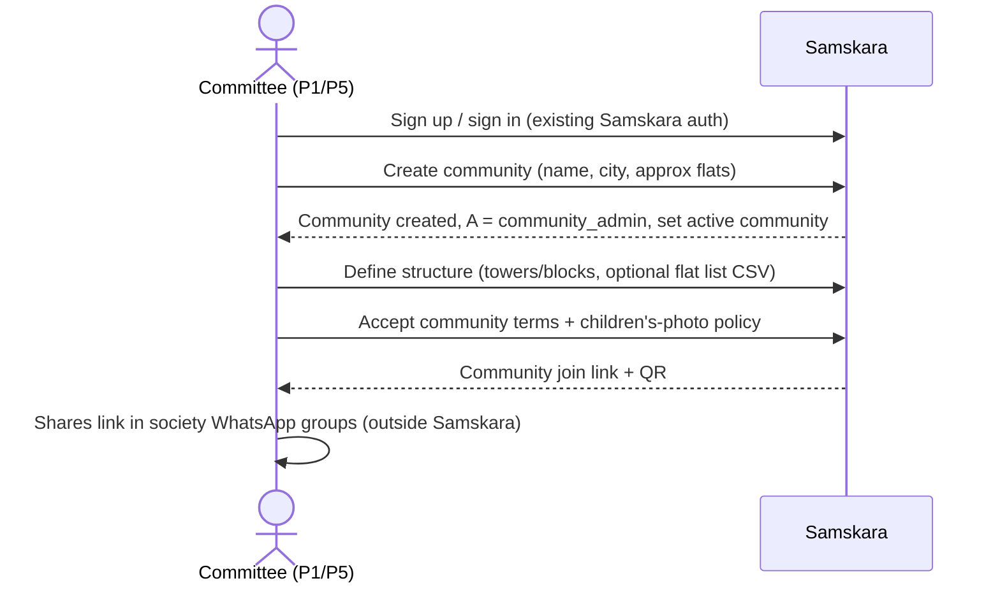
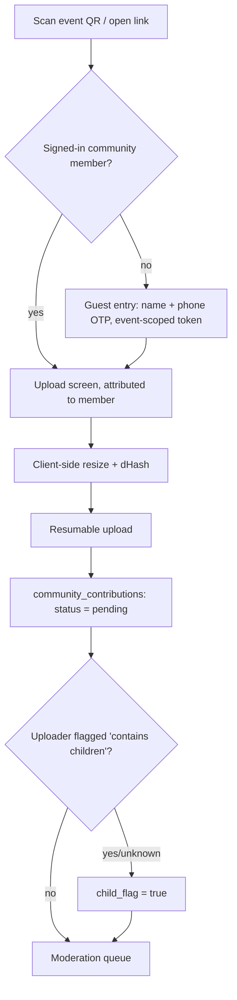
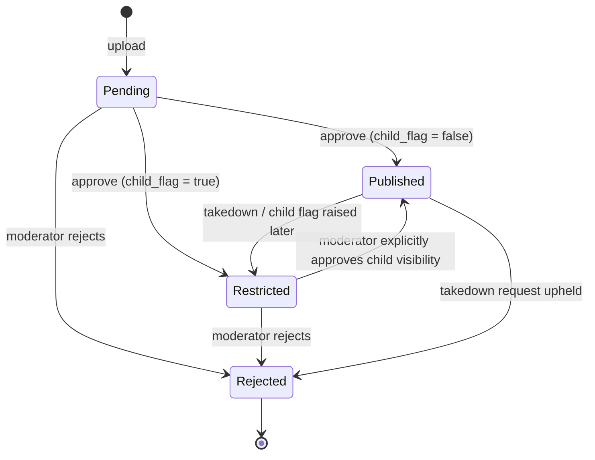

# 03 — Personas and User Journeys

Scope: pilot MVP for one society. Each journey lists the essential steps and 2-3 edge cases. Anything beyond that is deliberately left unspecified until pilot data justifies it.

## Personas

### P1. Association / Management Committee member ("Ramesh", 58, secretary)
- Elected for 1-2 years. Holds the budget and decides whether the society adopts a tool.
- Cares about: no extra workload, no privacy complaints from residents, a visible benefit for the AGM.
- Fears: a child's photo going somewhere it shouldn't, being blamed for a vendor's mistake, yet another app.
- **Role in product:** `community_admin` or `moderator`. Approves the society's onboarding and holds the final say on children's-photo visibility.

### P2. Cultural Committee member ("Priya", 38, festival organizer)
- Runs Ganesh/Navratri/Diwali. Does the actual work.
- Cares about: getting photos from everyone quickly, making a nice album, credit for the event.
- **Role in product:** `moderator`. Creates events, shares QR codes, clears the moderation queue. This is the most likely **champion** user.

### P3. Resident ("Anand", 45; "Meera", 72; "Kavya", 16)
- Spans ages and comfort with tech. Uses WhatsApp daily; may never install another app.
- Cares about: finding photos of their own family, and not having their kids' photos exposed.
- **Role in product:** `resident` member linked to a flat. Can upload, view published albums, and link media to a personal Samskara archive.
- **Note:** under-18 residents (Kavya) are not account holders in the MVP. Their media is governed by the children's-photo rules.

### P4. Guest / Event Photographer ("Suresh", hired photographer, or a visiting relative)
- Not a resident. Contributes to one event only.
- **Role in product:** no standing membership. Uploads through an ephemeral, event-scoped QR/link entry, and can't view anything beyond their own uploads.

### P5. Community Administrator (Samskara ops / the society's tech volunteer)
- Sets up the community, fixes membership mistakes, handles committee transitions.
- **Role in product:** `community_admin`. During the pilot, Samskara staff will probably play this role alongside the society volunteer.

## Roles summary

| Role | Source | Can |
|---|---|---|
| `community_admin` | `community_members.role` | everything a moderator can + roles, settings, handover |
| `moderator` | `community_members.role` | create events, approve/reject, approve child-photo visibility |
| `resident` | `community_members.role` + flat link | upload, view published, link to own family archive |
| event guest | ephemeral event upload token | upload to one event; see own uploads only |

---

## J1. Community onboarding

Steps:
1. A committee member signs in with existing Samskara auth and creates the community. They become `community_admin` and the community becomes their active tenant (`set_active_community()`, mirroring `set_active_family()`).
2. They add towers/blocks. Flats are optional (as a CSV, or created as residents join).
3. They confirm the children's-photo policy and acknowledge the default.
4. They receive a **community join link + QR** to share themselves.

Edge cases:
- **Duplicate society:** two committee members each create the same society. Admins can archive a duplicate before any media exists; Samskara ops merges by hand during the pilot.
- **Creator isn't really on the committee:** during the pilot Samskara ops verifies by hand (a call with the secretary). There is no automated verification.
- **User already in a family tenant:** the community membership sits alongside the family membership, and the active pointer is independent per tenant type.

## J2. Resident onboarding

1. A resident taps the join link from the society WhatsApp group (or scans a notice-board QR).
2. They sign in or sign up (phone OTP / existing Samskara auth).
3. They select tower and flat, and enter their household relationship (owner / tenant / family member).
4. Membership is created as **pending** until a moderator/admin approves it, or auto-approved if the community enables "trust join link" (default off).
5. Once approved, they see published albums.

Edge cases:
- **Two households claim the same flat** (for example, an owner and a tenant): both are allowed and the moderator sees the conflict flag.
- **Leaked join link** (forwarded outside the society): pending approval is the safeguard. The admin can rotate the link.
- **Elderly resident can't complete it:** a family member in the same flat can upload for the household. Assisted onboarding is out of MVP scope.

## J3. Festival event creation

1. A moderator creates an event: name, date(s), type (festival/sports/cultural/other), an optional cover.
2. The system generates an **event upload QR + link** (ephemeral, time-boxed, defaulting to the event start until 7 days after the event end).
3. The moderator downloads a printable QR poster and shares the link in WhatsApp groups.

Edge cases:
- **Multi-day event** (Navratri, 9 nights): one event with a date range. Sub-albums per day are optional.
- **Event cancelled or renamed:** editable. Revoking the upload link stops new uploads immediately.
- **Upload window needs extending:** the moderator extends the link expiry.

## J4. Media contribution via QR

Steps:
1. Scan the QR at the venue or tap the WhatsApp link.
2. Members upload under their own identity. Guests verify a phone number with OTP and get an **event-scoped, ephemeral token** (in the `content_shares` style) with no community membership.
3. Select multiple photos/videos. The client resizes and hashes them (`src/lib/imageResize.js`, `src/lib/imageHash.js`).
4. For each batch, the uploader answers "**Does this include children?**" (Yes / No / Not sure). The default is **Not sure**, which is treated as Yes.
5. Everything lands as `pending`. Nothing is visible to other residents until moderated.

Edge cases:
- **Poor connectivity at the venue:** uploads queue on the device and resume (see 05 NFR).
- **Duplicates:** a near-duplicate dHash is flagged to the moderator, not silently dropped.
- **Guest tries to browse the album:** not allowed. The guest sees only their own uploads and their status.

## J5. Album creation (with "intelligent" assistance)

1. The moderator opens the event queue. Near-duplicates are grouped (by dHash distance).
2. They approve or reject individually or in bulk. Items marked as having children go to a separate **"Children: review visibility"** tab.
3. Approved non-child media publishes to the event album for all approved residents.
4. For child-flagged items the moderator chooses: **publish to community**, **keep restricted** (uploader + committee only), or **reject**. Publishing is an explicit, logged, per-item (or per-selection) action.
5. Optional (MVP stretch): AI-suggested caption/tags via `callOpenAI`, which the moderator accepts or edits.

Moderation state machine:

Edge cases:
- **Moderator unsure whether a child is present:** leave it Restricted (the safe default).
- **A resident later asks for a takedown** of a published photo of their child: it goes back to Restricted immediately when a moderator acts. A resident's report flag hides it from others pending review.
- **Queue too large** (for example, 2,000 photos after Diwali): bulk approve with duplicate collapsing. Blur detection is *not* built; we measure the queue-clearing time instead.

## J6. Community memory discovery

1. A resident opens the community, sees a **timeline by year**, picks a year, then an event, then the album grid.
2. They can filter by event type and search by event name.
3. They open a photo, download it (if the community allows that), or link it to their personal archive (J7).

Edge cases:
- **New resident sees history from before they joined:** yes. Published history is community property and visible to all approved members (a deliberate continuity choice).
- **Former resident:** see J8.

## J7. Connecting to personal Samskara

1. On a published photo the resident taps **"Save to my family archive"**.
2. If they belong to several families, they pick one. The saved item is a new family-scoped record (a copy or reference), attributed "from <Community> / <Event>".
3. The family-side record follows family RLS. Removing it from the family archive doesn't affect the community copy, and vice versa.

Edge cases:
- **Resident has no family archive yet:** prompt them to create one (the family-product acquisition path).
- **Photo is Restricted:** it can't be saved, except by the uploader and only for their own upload.
- **Community later rejects the photo:** the family copy stays. It's the family's decision, and the takedown applies only to the community. (Open question, see report.)

## J8. Household moves out

1. A resident marks their household as moved out, or an admin does it.
2. Their `community_members` rows become `former`. They lose access to the community.
3. **Media they contributed stays in the community archive** (community-owned, per the terms they accepted at upload).
4. Anything they saved to a family archive (J7) stays with them.

Edge cases:
- **Former resident asks for their uploads to be removed:** the admin can unpublish them. This is honored as a DPDP-style erasure request for their personal data.
- **Tenant moves out while the owner stays:** this is per-member, not per-flat.
- **New occupants of the same flat:** they join fresh. No history is inherited from the previous household's membership.

## J9. Association committee changes

1. The outgoing admin promotes the incoming members to `community_admin`/`moderator`.
2. The outgoing members are demoted to `resident` (or `former`).
3. All events, albums and settings are unaffected. **This is the continuity guarantee.**

Edge cases:
- **The last admin leaves without handing over:** Samskara ops can reassign the admin role after manual verification with the new committee (a pilot-era manual process). The system must refuse to demote the last remaining `community_admin`.
- **Contested committee** (two factions): Samskara doesn't arbitrate. Changes are frozen until the general body's decision is documented to ops.
