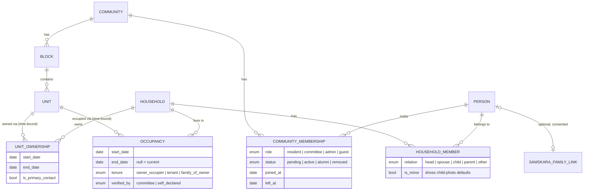
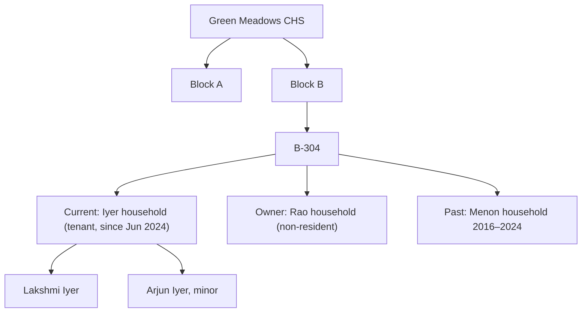

# 06 — Community (Residential) Tree Design

**Scope:** the residential structure of one housing society: Community → Block/Building → Unit → Occupancy → Household → Members. This is a strict hierarchy, so it has no spouse pairing, no generation rows and no birth-year tiers. `src/lib/classicTreeLayout.js` and `ClassicTree.jsx` are **not** reused. This view needs a plain collapsible list or org-chart, built new.

## 1. Core modelling decisions

1. **Unit is permanent; household is temporary.** A unit (for example "B-304") exists for the whole life of the building. Households pass through it. The link between the two is an **Occupancy**: a record with a start date and an optional end date. It is never a direct foreign key from household to unit.
2. **Ownership and residence are separate facts.** `UnitOwnership` records who owns the flat and over what period. `Occupancy` records who lives there and over what period. Here is a common Indian case: the owner lives in Bengaluru, a tenant family lives in the flat, and both are association members with different rights. Three cases come out of this:
   - owner-occupied: an ownership record and an occupancy record, both for the same household
   - rented: the owner's household has ownership with no occupancy, and the tenant household has occupancy with `tenure = tenant`
   - vacant: an ownership record and no current occupancy
3. **"Current" is computed, never stored as a flag.** A household is current at a unit when it has an occupancy with `end_date IS NULL OR end_date > today`. This avoids stale `is_current` booleans when committees forget to update them.
4. **Association membership is a third, independent axis.** `CommunityMembership` links a *person* to the *community*, with a role and a status. It can exist with no unit at all. Examples:
   - an owner's adult child who is pending a unit assignment
   - a committee volunteer who has just moved out
   - the society's photographer or caretaker
   Linking to a unit is optional and goes through household membership.
5. **Moving out ends an occupancy. It does not delete anything.** The household record, its contributions and its "lived here 2019–2025" history stay. What the moved-out person can still see is set by membership status (see §4).

## 2. Entity diagram

Tree as seen in the UI. The occupancy layer is shown as a "Current / Past" split inside each unit, not as a separate node level:

## 3. Visualization and loading

- **No layout algorithm.** The view is a nested accordion, Block → Units → Household chip. It is mobile-first and reuses `.card`, `.section-head` and the `tree-mode-toggle` pill styling from `TreeView.jsx`. An optional "building view" lays out a block as a floors × flats grid of small cells, coloured by occupancy state. That grid is a CSS grid, not a tree diagram.
- **Search comes first.** The top of the screen is a single field: "Find a flat or family (e.g. B-304, Iyer)". Most visits are "where is X", not browsing.
- **Load one block at a time.** On first load, fetch only block summaries: name, unit count, number of active member households. A block's units are fetched when that block is expanded, through one paginated query (50 units per page; most blocks are under 100). Household detail is fetched only when its profile opens.
- **Pilot reality.** At 100–500 flats, one block payload is small. The paging is there so the API shape is correct from the start, not because performance needs it. Don't build virtualised lists for the MVP.

## 4. Visibility for current vs past residents

| Who | Sees in residential tree | Sees in memories |
|---|---|---|
| Active resident | Block and unit structure. Household *display name* only for households that opted in (default: "Flat B-304", no name). | All published events |
| Committee/admin | All households, members, contact info, ownership vs tenancy | Everything, including pending items |
| Alumni (moved out, membership kept) | Their own past household entry, marked "2016–2024". Nobody else's current details. | Events dated during their occupancy, plus anything they contributed |
| Removed | Nothing | Nothing. Their past contributions stay published under the community's licence unless they request removal (see 09, screen 20) |

Unit names are not hidden from residents, because flat numbers are already common knowledge. Household names *are* hidden by default, because a public resident directory is a privacy and spam risk and is not the product's purpose.

## 5. Open questions
- Should owners be allowed to self-declare occupancy, or must the committee verify it? Proposal for the pilot: self-declare, then committee verifies, using the same Pending pattern as `AdminView.jsx`.
- Should alumni status expire? Proposal: no automatic expiry in the pilot; revisit after year one.
