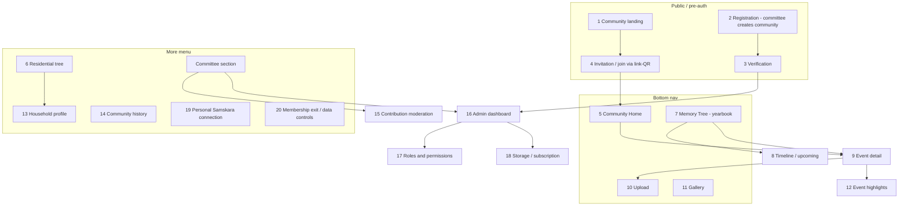

# 08 — Information Architecture

Communities reuses the existing shell rather than adding a second app: `TopBar.jsx`, `BottomBar.jsx` (mobile bottom nav), `MoreMenu.jsx`, and `FamilySwitcher.jsx` (active-tenant switcher). A community is a new **tenant type** in the switcher, next to family archives.

## 1. Context switching (family ↔ community)
- `FamilySwitcher.jsx` is extended into a "Spaces" switcher with two sections: **My Families** and **My Communities**. Choosing an entry sets the active tenant together with `tenantType`.
- The bottom bar, home screen and theme accent change with the context. The palette stays the same (maroon/parchment). The community context uses a small building crest in place of the family crest (`tree-crest-badge` slot), so users can always tell which space they are in.
- Nothing crosses between contexts implicitly. Family photos never appear in the community, and community photos never appear in the family. The only bridge is the explicit, per-item "Save to my family archive" and Personal-Samskara-link flow (screen 19).
- A resident with only a community lands straight in it. The switcher appears only when the user has two or more spaces, matching current behaviour.

## 2. Bottom nav in a community context
The family product uses Home / Tree / Timeline / Gallery / Search / More. Communities mirrors it as five tabs:

| Tab | Screen | Notes |
|---|---|---|
| Home | Community Home (5) | |
| Memories | Memory Tree, yearbook (7), with timeline toggle (8) | Takes the "Tree" slot, because memories are the core |
| **+ Add** | Collaborative Upload (10) | Centre action. Picks an event first, defaulting to the current Live event |
| Gallery | Community Gallery (11) | Search sits inside Gallery as a filter bar. The family product's separate Search tab is not repeated here |
| More | MoreMenu | |

The residential tree is deliberately **not** a primary tab. Residents rarely browse flats, so it lives under More.

## 3. Screen map (20 screens from the brief)

**Level summary**
- Top-level (bottom nav): 5, 7, 10, 11, plus More
- One tap from Home: 9 (cards for the Live/upcoming event), 15 (a "N items to review" banner for the committee only), 13 ("My household" card)
- More menu (all users): 6, 14, 19, 20, Help, Privacy
- More → Committee section (only shown to `committee`/`admin`): 15, 16, 17, 18
- Drill-down only: 8 (toggle inside 7), 12 (inside 9), 13 (from 6 or Home)
- Pre-auth / one-off: 1, 2, 3, 4. Screen 4 is the deep-link target of the WhatsApp-shared link/QR

## 4. Pilot simplifications
- 12 Highlights is a section of 9 and a filter in 11, not a standalone route.
- 8 is a view toggle, not a separate route.
- 17 and 18 are tabs inside 16, following the tabbed `AdminView.jsx` pattern. 18 reuses `PlansView.jsx` for the subscription UI.
- 3 Verification is a manual step for the pilot: Samskara staff approve the community through `SuperAdminView.jsx`. No document-upload KYC pipeline.

The result is about **12 distinct routes** for the pilot:
- landing
- register + verify
- join
- home
- memories
- event
- upload
- gallery
- residential tree
- household
- history
- one "My membership" route (19 + 20)

The committee adds 2 more: moderation, and the admin dashboard with its tabs. Together these cover all 20 brief screens.
