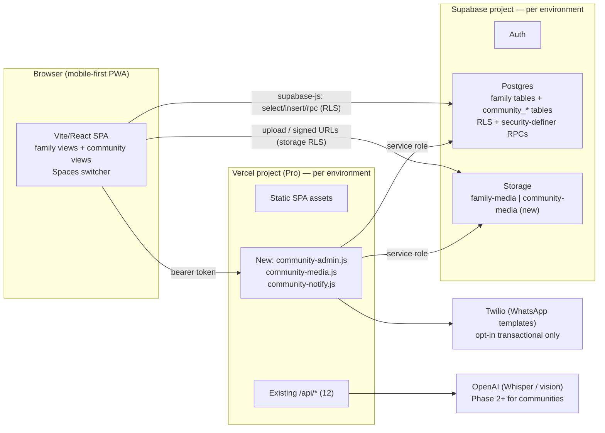

# 10 — Technical Architecture

## 1. The one-paragraph answer

Samskara Communities runs on **the same architecture as the family product. It is not a new system.** It is the same Vite/React SPA, served from the same Vercel project in each environment, and it talks to the same Supabase project (Postgres, Storage, Auth, RLS), with Twilio for the one opt-in notification path. There is **no new backend framework, no second database, no microservices, no queue service and no separate deployment.** A community is a second **tenant type** next to families. It adds a second set of `community_*` tables, one new private Storage bucket (`community-media`), its own security-definer helper functions (`current_community_id()` and friends, mirroring `current_family_id()`) and a few new serverless endpoints. Most reads and writes go straight from the browser to Supabase and are guarded by RLS, exactly as the family product does today. Serverless functions are used only for work that needs the service-role key, a third-party secret (Twilio, OpenAI) or a cross-tenant operation.

## 2. Deployment topology (unchanged)

**Two environments, identical shape** (`docs/ENVIRONMENTS.md`). Test is `dev` → `samskara-koaham.vercel.app` → the test Supabase project. Production is `main` → `oursamskara.com` → the production Supabase project. Every community migration, bucket and policy reaches both through the same ordered `supabase/migrations/` replay. New environment variables are added per Vercel project. Only one is new: `CRON_SECRET`, for the lifecycle sweep, see §5. The design adds no shared resource between the two stacks.

**Vercel Pro.** The upgrade has been approved, so the Hobby limit of 12 functions no longer applies. Even so, new endpoints follow the existing **action-multiplexed** pattern (`api/ai-tools.js`, `api/interview.js`: one file, `const { action } = req.body`, one shared auth gate). Admin operations share one gate and one secret surface, so splitting them into separate files would only spread the same auth code across several places.

## 3. Module map onto the stack

Legend:
- **B** = browser goes straight to Supabase under RLS
- **R** = browser calls a security-definer RPC (`supabase.rpc`)
- **S** = serverless endpoint (service role or third-party secret)
- **T** = Postgres trigger

| Module | What it owns | Data (doc 11) | Path | Notes |
|---|---|---|---|---|
| **Community Management** | Create community, settings, branding, Spaces switcher | `communities`, `user_preferences.active_community_id` | **S** to create (`community-admin` `provision`), **B** to update settings, **R** to `set_active_community` | Creating a community is a superadmin step during the pilot, the same as `provision-family.js`. Self-registration (screen 2) comes later. |
| **Building/Unit Management** | Blocks, units, bulk import | `community_blocks`, `community_units` | **B** (moderator RLS), **S** for CSV bulk import (`community-admin` `import_units`) | Bulk import runs on the server so 400 units go in one transaction with validation. Hand entry is direct. |
| **Membership/Household** | Join requests, roles, households, occupancy and ownership | `community_members`, `community_households`, `community_household_members`, `community_occupancies`, `community_unit_ownerships` | **B** for apply/self-declare/approve, **R** `community_unit_summary`, **S** for `set_role` (last-admin guard) and `create_member_login` | Mirrors `api/create-member-login.js`: the committee creates logins for elderly residents |
| **Events** | Events, activities, Live/Closed lifecycle | `community_events`, `community_event_activities` | **B** | Plain CRUD under moderator RLS |
| **Media / Albums** | Upload, gallery, event album (event = album) | `community_media`, storage `community-media` | **B** to upload and insert, **B** for signed URLs | Generalised `mediaUpload.js` (doc 14 §2) |
| **Event QR / link upload** | Event-scoped upload access | `community_upload_links`, `community_event_grants` | **B** to create link (moderator insert), **R** `redeem_community_upload_link` | Follows the `invites`/`content_shares` precedent, *not* WhatsApp (§6). The QR image is drawn client-side from the URL. |
| **Media Processing** | Resize, dHash, video poster, EXIF date | columns on `community_media` | **Browser only** for the pilot | `imageResize.js`/`imageHash.js` reused as-is. No server transcoding (doc 14). |
| **Memory Timeline** | Year → Event → Media yearbook, timeline toggle | reads over events and contributions | **B** and **R** `community_year_index` | No separate memory table. `kind='memory'` events cover undated memories. |
| **Moderation** | Review queue, minor hold, takedown, withdrawal | `community_contributions`, `community_moderation_actions` | **B** to submit (pending only), **R** `moderate_community_contribution` / `withdraw_community_contribution` | No direct UPDATE policy. Every state change goes through an RPC and is logged. The publish gate is a CHECK constraint. |
| **Permissions** | Roles, active-tenant resolution, save-to-family rules | helper functions, `community_media_permissions` | **R** (`current_community_id`, `is_community_moderator`, …) used inside every RLS policy | All checks key off `current_community_id()`, so an admin in community A is never an admin in community B |
| **Family bridge** | "Save to my family archive" | `community_family_links`, plus `family-media` and `contributions` on the family side | **S** (`community-media` `save_to_family`) | Must be serverless: it reads one bucket and writes another across two trust domains, which no single user's RLS context can do |
| **Notifications** | Opt-in transactional WhatsApp ("your photos were approved") | `community_notification_optins` (doc 12 §5) | **S** (`community-notify`) | Uses `_whatsappAuth.js` and the `serviceClient()` pattern. No broadcast; the committee shares links in its own WhatsApp group (decision #1). |
| **Subscription/Billing** | Tier, limits, overrides | `community_subscriptions`, `community_plan_limits` | **T** enforcement, **B** read (admin), **S** superadmin changes | Limits are generated from `communityPlans.json` (doc 11 §11). No payment flow in the pilot. |
| **Auditing** | Security change log | `community_audit_log` | **T** only, **B** read (admin) | Append-only, with no client write policy |

## 4. What goes direct from the browser vs. serverless

The rule is the same one the family product already follows. **Serverless is used only when at least one of these is true:**

1. The operation needs `SUPABASE_SERVICE_ROLE_KEY`: creating auth users, writing tables that have no client policy, or crossing tenants.
2. The operation needs a third-party secret: `TWILIO_*` or `OPENAI_API_KEY`.
3. The operation is a scheduled job: the Vercel Cron lifecycle sweep.
4. The operation is a bulk transaction that is easier to validate in one place than across N browser calls.

Everything else goes direct, including token *redemption*. `redeem_community_upload_link()` is a security-definer RPC, exactly like `redeem_invite()` and `redeem_content_share()`. It needs no service role, because the security-definer function is what grants the privilege. Token *generation* is also direct: a moderator inserts into `community_upload_links` under RLS, and `gen_random_bytes(16)` creates the code inside the database. The brief assumed QR generation needed a serverless function. With this existing pattern, it does not.

New serverless files (full details in doc 12):

| File | Actions | Why serverless |
|---|---|---|
| `api/community-admin.js` | `provision`, `import_units`, `set_role`, `create_member_login`, `reset_member_password`, `set_subscription` | Service role (auth admin, no-client-policy tables), superadmin secret |
| `api/community-media.js` | `save_to_family`, `lifecycle_sweep` (cron), `export_event_zip` (Phase 2) | Cross-bucket and cross-tenant copy, storage deletes on a schedule |
| `api/community-notify.js` | `send` (internal), `optin_start`, `optout` | Twilio secrets |

The Twilio *inbound* path stays in the existing `api/whatsapp-webhook.js`. A STOP or opt-out reply for community notifications is handled there through a small branch, so a second Twilio webhook URL is never configured.

## 5. Cross-cutting concerns

**Auth.** Supabase Auth is the same system for both products, and one login can hold family and community memberships. For QR guests, see doc 12 §4. The recommendation is Supabase **anonymous sign-in**: it gives a real `auth.uid()`, so every RLS policy works unchanged, and the account can later be upgraded to a full one. This needs a product-owner decision.

**Tenant context.** The browser never sends a community id that the server trusts. RLS resolves `current_community_id()` from `community_members` and the `user_preferences` pointer. The SPA sends `community_id` in inserts only so the `with check` can compare it. Serverless endpoints re-derive membership from the bearer token on every call, the same way `api/_memberAuth.js`'s `requireModerator` does today. They never trust ids in the request body.

**Shell integration** (doc 08). `FamilySwitcher.jsx` becomes a Spaces switcher. Its community entries call `set_active_community()`, and its family entries call the existing `set_active_family()` and then `set_active_space('family')`. Community views are lazy-loaded routes (`lazyWithReload.js`), so the family bundle does not grow for users who never join a community.

**Feature flagging.** Communities are behind a `SHOW_COMMUNITIES` flag in `src/lib/featureFlags.js`. It is on in test and off in production until the pilot is ready. The schema ships to both environments, because migrations replay to both. Without community rows, the tables simply sit empty in production.

**Scheduled work.** One Vercel Cron entry in `vercel.json`, daily at `/api/community-media` with `{action: "lifecycle_sweep"}`, authenticated with `CRON_SECRET`. It deletes orphaned objects, purges rejected or withdrawn files after the grace period, and expires grants (doc 14 §6). This is the first cron in the repo. It is allowed on Pro.

**Observability.** The pilot uses what exists today: Vercel function logs, Supabase logs, and `community_audit_log` for security-relevant changes. No new APM.

## 6. Explicit non-reuse decisions

| Existing component | Reused? | Reason |
|---|---|---|
| `family_role` enum | No | Head/admin/member and admin/committee/resident/guest have different meanings. Sharing the type would couple the two products. |
| `contributions` table | No (pattern only) | Its FKs are tied to the family tree, and sharing one RLS surface across two trust domains is design-review risk #9 |
| `family-media` bucket | No (pattern only) | A community item's visibility changes after upload, so the read policy also checks the row (doc 11 §10) |
| WhatsApp conversation engine (`_whatsappConversation.js`, `whatsapp_connections`) | No for uploads | It resolves identity through a standing phone-to-user link. An event QR is an ephemeral grant scoped to one event. |
| `_whatsappAuth.js`, `serviceClient()` | Yes | For signature validation and service-role access in the notification path |
| `imageResize.js`, `imageHash.js` | Yes, as-is | They do not depend on any tenant |
| `mediaUpload.js` | Generalised | Bucket and path prefix become parameters (doc 14 §2) |
| `planTiers.js` + SQL mirror | Pattern, improved | Generated from shared JSON, with a CI check (doc 11 §11) |
| `_aiAuth.js` entitlement gate | Phase 2 | Gains a community-tier branch when AI features reach communities |

## 7. Risks

1. **Storage read policy cost.** Each signed-URL request runs `can_read_community_object()`, which looks up `community_media` by `storage_path`. The unique index on that column handles it, and at pilot scale it is negligible. Batch signing (`createSignedUrls`, 50 at a time) checks the policy once per object. Watch this if galleries ever sign 500 URLs at once.
2. **Signed-URL lifetime.** `mediaUpload.js` signs family URLs for **one year**. That cannot carry over: a signed URL keeps working after the item is hidden or minor-held. Community URLs must be short-lived, 1 hour, and re-signed on view. This changes the hydrate-everything-at-boot model the family product uses (doc 14 §2).
3. **Two active-tenant pointers.** The SPA must always know which space it is rendering. If a component reads family data while `active_space='community'`, it will still read the active family's data, because RLS is satisfied. That is a UI confusion bug, not a data leak, but it is real. Mitigation: community views import only from a `src/lib/community/` module, and code review checks for it.
4. **First cron and first service-role cross-bucket copy.** Both are new operational surfaces. Test both in the test environment against seeded data before production.
