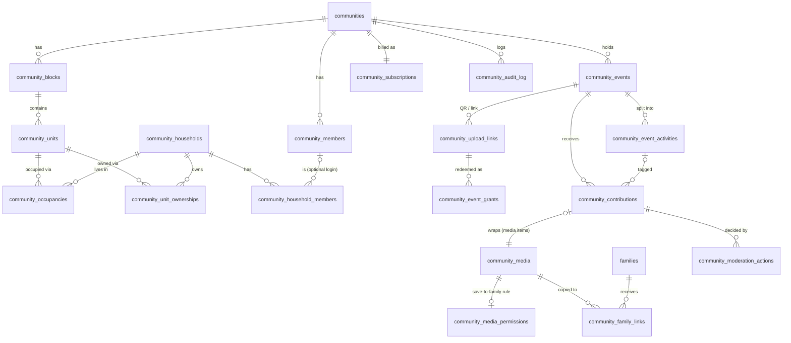

# 11 — Database Design

**Status:** design, migration-ready. Nothing here has been run. All of it is meant to go into `supabase/migrations/` as new, append-only files (per `docs/GIT_WORKFLOW.md`), replayed identically against the test and production Supabase projects (per `docs/ENVIRONMENTS.md`).

**Grounded in:**
- `20260723180000_multitenant_schema.sql`: `families`, `family_members`, `current_family_id()`, `is_moderator()`, the `contributions` Pending-insert RLS shape, `invites`
- `20260726120000_multi_family_membership.sql`: `user_preferences.active_family_id` and `set_active_family()`
- `20260723180100_storage_bucket.sql` and `20261013120000_contribution_visibility.sql`: the `family-media` path-prefix storage policies and the `__private__` reserved-segment trick
- `20260930120000_content_shares.sql`: the single-use code that a moderator creates and a security-definer function redeems
- `20261016120000_subscription_plans.sql` and `20261017120000_plan_enforcement.sql`: plan tiers enforced by triggers

## 1. Design rules (non-negotiable)

1. **A separate trust domain.** Every community table is new and prefixed `community_`. No community table has a foreign key into `people`, `contributions`, `experience_entries` or any other family-tree table. The one exception is `community_family_links`, the explicit bridge, and it references `families(id)` only. This is design-review risk #9. Two trust domains must not share one RLS surface.
2. **Mirror the family mechanism exactly.** The tenant tables are `community_members(community_id, user_id, role)`. The active-tenant function is `current_community_id()`, a security-definer function. The pointer is `user_preferences.active_community_id`, changed only through `set_active_community()`. No JWT claims and no tenant ids supplied by the client.
3. **The family functions are not modified.** `current_family_id()`, `is_moderator()` and `current_family_role()` stay exactly as they are. The two pointers are independent. Switching into a community never changes which family is active. This guarantees zero behaviour change for the family product.
4. **"Current" is computed, never stored** (doc 06 §1.3). Occupancies carry `start_date`/`end_date`. There is no `is_current` column anywhere.
5. **Privacy is enforced in the database.** Visibility of unpublished items and items showing minors is enforced by RLS on the table and by the storage policy. It is never only an app-layer filter. `20261013120000_contribution_visibility.sql` documents why an app-layer filter alone is not enough.
6. **Tenant isolation from day one. Scale optimisation later.** The pilot is one community. Indexes cover realistic pilot queries and nothing more: no partitioning, no materialised views.

## 2. Naming decisions

| Brief entity | Table | Note |
|---|---|---|
| Community | `communities` | |
| CommunityMembership | `community_members` | Mirrors `family_members` |
| CommunityRole | enum `community_role` | Folded into an enum, with no table. The role set is fixed for the pilot. The committee's human title ("Secretary", "Cultural Secretary") is free text in `community_members.title`, so a title is not a permission. |
| Building | `community_blocks` | Named **block** to match doc 06 and the UI copy ("Block B"). A tower is a block. *Product owner: confirm the term.* |
| Unit | `community_units` | |
| UnitOccupancy | `community_occupancies` | Plus `community_unit_ownerships` (doc 06 §1.2 requires ownership to be separate) |
| Household / HouseholdMember | `community_households`, `community_household_members` | |
| Event / EventActivity | `community_events`, `community_event_activities` | |
| Album | **folded into Event** | An event *is* the album (doc 07 is Year → Event → Media). Activities give sub-grouping ("Rangoli", "Kids' fancy dress"). A separate album table would duplicate every event row. |
| CommunityMemory | **folded into Event** | `community_events.kind = 'memory'` covers undated or non-event memories ("The old banyan tree before 2015"). Text stories are `community_contributions` rows with `item_type = 'story'`. A separate table would need its own media FK, its own moderation path and its own timeline query, all for an object that differs from an event only by not having a schedule. |
| CommunityMedia / MediaAsset | `community_media` | One row per stored file |
| CommunityContribution | `community_contributions` | The moderation queue. Carries `contains_minor` and `visibility_state`. |
| MediaPermission | `community_media_permissions` | Rules for the "Save to my family archive" action |
| FamilyMemoryLink | `community_family_links` | Audit and dedup record of each copy made into a family Folio |
| ModerationAction | `community_moderation_actions` | Append-only decision log shown in the UI |
| CommunitySubscription | `community_subscriptions` + `community_plan_limits` | Limits table generated from shared config (§11) |
| AuditLog | `community_audit_log` | Append-only, written by triggers |
| *(new)* | `community_upload_links`, `community_event_grants` | The event QR or link token. Follows the `content_shares`/`invites` shape, not WhatsApp. |

## 3. ER diagram



## 4. Migration plan (file order)

| File | Contents |
|---|---|
| `20261020120000_communities_core.sql` | enums, `communities`, `community_members`, pointer column, helper functions, `set_active_community` |
| `20261020120100_communities_residential.sql` | blocks, units, households, household members, occupancies, ownerships |
| `20261020120200_communities_events_media.sql` | events, activities, media, contributions, permissions, family links |
| `20261020120300_communities_moderation.sql` | moderation actions, the `moderate_community_contribution()` RPC |
| `20261020120400_communities_upload_links.sql` | QR/link tokens, grants, `redeem_community_upload_link()` |
| `20261020120500_community_media_bucket.sql` | `community-media` bucket and storage policies |
| `20261020120600_communities_plans.sql` | subscriptions, plan limits (**generated**, see §11), enforcement trigger |
| `20261020120700_communities_audit.sql` | audit log and triggers |

Each file is self-contained and depends only on earlier ones, so a fresh replay (`scripts/migrate-to-prod.mjs`, or a new project) runs in order with no manual step.

---

## 5. Core: communities, membership, active-tenant pointer

```sql
-- 20261020120000_communities_core.sql
--
-- Samskara Communities — a second tenant type alongside families. Mirrors
-- 20260723180000_multitenant_schema.sql + 20260726120000_multi_family_membership.sql
-- exactly (members table + security-definer "which tenant am I in" function
-- + server-verified active pointer), but as entirely separate tables: a
-- community is a different trust domain from a family (different people,
-- different consent expectations), so nothing here shares an RLS surface
-- with families/people/contributions. current_family_id() and friends are
-- deliberately NOT touched — the family product's behavior is unchanged.

-- Own enum, not family_role: head/admin/member mean "family elder /
-- archive keeper / relative"; these mean "association admin / elected
-- committee / resident / event-only guest" — different powers, and
-- reusing the type would invite a future change to one silently changing
-- the other.
create type community_role as enum ('admin', 'committee', 'resident', 'guest');
create type community_member_status as enum ('pending', 'active', 'alumni', 'removed');

create table communities (
  id uuid primary key default gen_random_uuid(),
  name text not null,
  slug text not null unique check (slug ~ '^[a-z0-9-]{3,48}$'),
  city text,
  registration_no text,           -- society registration number, optional
  founded_year int check (founded_year between 1900 and 2100),
  settings jsonb not null default '{}'::jsonb, -- e.g. {"show_household_names": false}
  created_at timestamptz not null default now()
);

create table community_members (
  id uuid primary key default gen_random_uuid(),
  community_id uuid not null references communities(id) on delete cascade,
  user_id uuid not null references auth.users(id) on delete cascade,
  role community_role not null default 'resident',
  status community_member_status not null default 'pending',
  title text,                     -- display only ("Secretary"); never checked for permissions
  display_name text,
  joined_at date,
  left_at date,
  created_at timestamptz not null default now(),
  unique (user_id, community_id)  -- same shape as family_members_user_id_family_id_key
);
create index community_members_community_role_idx on community_members (community_id, role, status);

-- Independent pointer — switching community never touches active_family_id.
-- active_space is UI-only (which context the shell opens into); it is never
-- read by any RLS policy.
alter table user_preferences
  add column active_community_id uuid references communities(id) on delete set null,
  add column active_space text not null default 'family' check (active_space in ('family', 'community'));

-- Same ordering trick as current_family_id(): prefer the stored pointer,
-- fall back to earliest membership; can never return a community the
-- caller has no row in. 'removed' and 'pending' memberships never resolve
-- (pending = applied, not yet approved by committee — sees nothing yet).
create or replace function public.current_community_id()
returns uuid language sql stable security definer set search_path = public as $$
  select cm.community_id
  from community_members cm
  where cm.user_id = auth.uid() and cm.status in ('active', 'alumni')
  order by
    (cm.community_id = (select up.active_community_id from user_preferences up where up.user_id = auth.uid())) desc,
    cm.created_at asc
  limit 1;
$$;

-- All role checks key off current_community_id(), for the exact reason
-- 20260726120000 had to fix is_moderator(): an admin in community A must
-- never evaluate as admin while viewing community B.
create or replace function public.current_community_role()
returns text language sql stable security definer set search_path = public as $$
  select role::text from community_members
  where user_id = auth.uid() and community_id = public.current_community_id();
$$;

create or replace function public.current_community_status()
returns text language sql stable security definer set search_path = public as $$
  select status::text from community_members
  where user_id = auth.uid() and community_id = public.current_community_id();
$$;

-- "Moderator" in community terms = admin or committee, active only. An
-- alumni ex-secretary keeps read access but loses moderation the day
-- their status changes.
create or replace function public.is_community_moderator()
returns boolean language sql stable security definer set search_path = public as $$
  select coalesce((
    select role in ('admin', 'committee') and status = 'active'
    from community_members
    where user_id = auth.uid() and community_id = public.current_community_id()
  ), false);
$$;

create or replace function public.is_community_admin()
returns boolean language sql stable security definer set search_path = public as $$
  select coalesce((
    select role = 'admin' and status = 'active'
    from community_members
    where user_id = auth.uid() and community_id = public.current_community_id()
  ), false);
$$;

-- Full resident (not guest, not alumni) — gate for residential-directory reads.
create or replace function public.is_community_resident()
returns boolean language sql stable security definer set search_path = public as $$
  select coalesce((
    select role in ('admin', 'committee', 'resident') and status = 'active'
    from community_members
    where user_id = auth.uid() and community_id = public.current_community_id()
  ), false);
$$;

create or replace function public.set_active_community(p_community_id uuid)
returns void language plpgsql security definer set search_path = public as $$
begin
  if not exists (
    select 1 from community_members
    where user_id = auth.uid() and community_id = p_community_id and status in ('active', 'alumni')
  ) then
    raise exception 'You are not a member of that community.';
  end if;
  insert into user_preferences (user_id, active_community_id, active_space)
  values (auth.uid(), p_community_id, 'community')
  on conflict (user_id) do update
    set active_community_id = excluded.active_community_id, active_space = 'community';
end;
$$;
grant execute on function public.set_active_community(uuid) to authenticated;

-- Pure UI toggle back to the family space; validates nothing because it
-- grants nothing (current_family_id() never reads active_space).
create or replace function public.set_active_space(p_space text)
returns void language sql security definer set search_path = public as $$
  insert into user_preferences (user_id, active_space) values (auth.uid(), p_space)
  on conflict (user_id) do update set active_space = excluded.active_space;
$$;
grant execute on function public.set_active_space(text) to authenticated;

alter table communities enable row level security;
alter table community_members enable row level security;

create policy "member can read own community" on communities for select
  using (id = current_community_id());
create policy "admin can update own community" on communities for update
  using (id = current_community_id() and is_community_admin())
  with check (id = current_community_id() and is_community_admin());
-- No insert policy: communities are created by api/community-admin.js
-- (action 'provision', service role), same as provision-family.js.

-- Roster: residents see active/alumni members of their community; guests
-- see only themselves (via the second policy). Moderators see everyone,
-- including pending applicants they need to approve.
create policy "resident can read roster" on community_members for select
  using (
    community_id = current_community_id()
    and (is_community_moderator() or (is_community_resident() and status in ('active', 'alumni')))
  );
create policy "user can read own community memberships" on community_members for select
  using (user_id = auth.uid());
-- Self-application to join (pending only, resident only — cannot self-grant committee).
create policy "user can apply to join" on community_members for insert
  with check (user_id = auth.uid() and status = 'pending' and role = 'resident');
-- Approvals / role changes: admin only, and an admin can't demote the
-- last admin (enforced in community-admin.js 'set_role', not RLS — RLS
-- can't express "count of other rows").
create policy "admin can manage roster" on community_members for update
  using (community_id = current_community_id() and is_community_admin())
  with check (community_id = current_community_id() and is_community_admin());
```

> **Self-apply, note.** The `user can apply to join` insert has no `community_id = current_community_id()` check, because the applicant is not a member yet. That lets anyone signed in create a pending row against any community id they know. It grants no read access, since `current_community_id()` ignores `pending`. The cost is spam into the approval queue. Community ids are UUIDs, so they are not guessable. For the pilot that is acceptable. If abuse appears, move joining behind a join-code RPC like `redeem_invite`.

---

## 6. Residential structure

```sql
-- 20261020120100_communities_residential.sql
--
-- Community -> Block -> Unit -> (Occupancy | Ownership) -> Household -> Member.
-- See docs/samskara-communities/06-community-tree-design.md. Units are
-- permanent, households pass through them; "current" is always derived
-- from end_date, never stored.

create type community_tenure as enum ('owner_occupier', 'tenant', 'family_of_owner');
create type community_verification as enum ('self_declared', 'committee');
create type household_relation as enum ('head', 'spouse', 'child', 'parent', 'sibling', 'other');

create table community_blocks (
  id uuid primary key default gen_random_uuid(),
  community_id uuid not null references communities(id) on delete cascade,
  name text not null,              -- "Block B", "Tower 2"
  floors int check (floors between 0 and 200),
  sort_order int not null default 0,
  created_at timestamptz not null default now(),
  unique (community_id, name),
  unique (community_id, id)        -- target for composite FKs below
);

create table community_units (
  id uuid primary key default gen_random_uuid(),
  community_id uuid not null references communities(id) on delete cascade,
  block_id uuid not null,
  label text not null,             -- "B-304"
  floor int,
  created_at timestamptz not null default now(),
  -- Composite FK: a unit can never point at another community's block,
  -- even via a service-role bug. Same intent as people's (family_id, id) keys.
  foreign key (community_id, block_id) references community_blocks(community_id, id) on delete cascade,
  unique (community_id, label),
  unique (community_id, id)
);
create index community_units_block_idx on community_units (block_id, label);

create table community_households (
  id uuid primary key default gen_random_uuid(),
  community_id uuid not null references communities(id) on delete cascade,
  display_name text not null,      -- "Iyer household"
  show_name_to_residents boolean not null default false, -- doc 06 §4: hidden by default
  created_by uuid references auth.users(id),
  created_at timestamptz not null default now(),
  unique (community_id, id)
);

create table community_household_members (
  id uuid primary key default gen_random_uuid(),
  community_id uuid not null,
  household_id uuid not null,
  display_name text not null,
  user_id uuid references auth.users(id) on delete set null, -- most members (kids, elders) have no login
  relation household_relation not null default 'other',
  is_minor boolean not null default false,
  birth_year int check (birth_year between 1900 and 2100),
  created_at timestamptz not null default now(),
  foreign key (community_id, household_id) references community_households(community_id, id) on delete cascade
);
create index community_household_members_household_idx on community_household_members (household_id);
create index community_household_members_user_idx on community_household_members (user_id) where user_id is not null;

create table community_occupancies (
  id uuid primary key default gen_random_uuid(),
  community_id uuid not null,
  unit_id uuid not null,
  household_id uuid not null,
  tenure community_tenure not null,
  start_date date not null,
  end_date date,                   -- null = current
  verified_by community_verification not null default 'self_declared',
  created_at timestamptz not null default now(),
  check (end_date is null or end_date >= start_date),
  foreign key (community_id, unit_id) references community_units(community_id, id) on delete cascade,
  foreign key (community_id, household_id) references community_households(community_id, id) on delete cascade
);
-- "Who lives in B-304 now / who lived there before" — doc 06's per-unit Current/Past split.
create index community_occupancies_unit_idx on community_occupancies (unit_id, start_date desc);
create index community_occupancies_household_idx on community_occupancies (household_id);

create table community_unit_ownerships (
  id uuid primary key default gen_random_uuid(),
  community_id uuid not null,
  unit_id uuid not null,
  household_id uuid not null,
  start_date date not null,
  end_date date,
  is_primary_contact boolean not null default false,
  created_at timestamptz not null default now(),
  check (end_date is null or end_date >= start_date),
  foreign key (community_id, unit_id) references community_units(community_id, id) on delete cascade,
  foreign key (community_id, household_id) references community_households(community_id, id) on delete cascade
);
create index community_unit_ownerships_unit_idx on community_unit_ownerships (unit_id, start_date desc);

-- Helper: is the caller a member of this household? Used to let a
-- resident edit their own household without being a moderator.
create or replace function public.is_own_community_household(p_household_id uuid)
returns boolean language sql stable security definer set search_path = public as $$
  select exists (
    select 1 from community_household_members
    where household_id = p_household_id and user_id = auth.uid()
      and community_id = public.current_community_id()
  );
$$;

alter table community_blocks enable row level security;
alter table community_units enable row level security;
alter table community_households enable row level security;
alter table community_household_members enable row level security;
alter table community_occupancies enable row level security;
alter table community_unit_ownerships enable row level security;

-- Blocks/units: flat numbers are common knowledge (doc 06 §4) — any
-- active/alumni member reads; only moderators write.
create policy "member reads blocks" on community_blocks for select using (community_id = current_community_id());
create policy "moderator writes blocks" on community_blocks for all
  using (community_id = current_community_id() and is_community_moderator())
  with check (community_id = current_community_id() and is_community_moderator());
create policy "member reads units" on community_units for select using (community_id = current_community_id());
create policy "moderator writes units" on community_units for all
  using (community_id = current_community_id() and is_community_moderator())
  with check (community_id = current_community_id() and is_community_moderator());

-- Households: names are private by default. Residents see opted-in
-- households + their own; moderators see all. Guests/alumni see only
-- their own (alumni: doc 06 §4 "their own past household entry").
create policy "read households" on community_households for select
  using (
    community_id = current_community_id()
    and (is_community_moderator()
         or is_own_community_household(id)
         or (is_community_resident() and show_name_to_residents))
  );
create policy "resident creates household" on community_households for insert
  with check (community_id = current_community_id() and is_community_resident() and created_by = auth.uid());
create policy "own or moderator updates household" on community_households for update
  using (community_id = current_community_id() and (is_community_moderator() or is_own_community_household(id)))
  with check (community_id = current_community_id() and (is_community_moderator() or is_own_community_household(id)));

-- Household members (incl. minors' names/birth years): never visible to
-- other residents. Own household + moderators only.
create policy "read household members" on community_household_members for select
  using (community_id = current_community_id() and (is_community_moderator() or is_own_community_household(household_id)));
-- The creator's first insert into a household they just created can't pass
-- is_own_community_household (no member row yet) — so it's allowed when
-- the caller created the household. Subsequent inserts use the own-household path.
create policy "write household members" on community_household_members for insert
  with check (
    community_id = current_community_id()
    and (is_community_moderator()
         or is_own_community_household(household_id)
         or exists (select 1 from community_households h where h.id = household_id and h.created_by = auth.uid()))
  );
create policy "update household members" on community_household_members for update
  using (community_id = current_community_id() and (is_community_moderator() or is_own_community_household(household_id)))
  with check (community_id = current_community_id() and (is_community_moderator() or is_own_community_household(household_id)));
create policy "delete household members" on community_household_members for delete
  using (community_id = current_community_id() and (is_community_moderator() or is_own_community_household(household_id)));

-- Occupancy/ownership: residents may self-declare for their own household
-- (doc 06 §5 proposal); only a moderator may mark it committee-verified.
create policy "read occupancies" on community_occupancies for select
  using (community_id = current_community_id() and (is_community_moderator() or is_own_community_household(household_id)));
create policy "declare occupancy" on community_occupancies for insert
  with check (
    community_id = current_community_id()
    and (is_community_moderator() or (is_own_community_household(household_id) and verified_by = 'self_declared'))
  );
create policy "moderator updates occupancy" on community_occupancies for update
  using (community_id = current_community_id() and is_community_moderator())
  with check (community_id = current_community_id() and is_community_moderator());

create policy "read ownerships" on community_unit_ownerships for select
  using (community_id = current_community_id() and (is_community_moderator() or is_own_community_household(household_id)));
create policy "moderator writes ownerships" on community_unit_ownerships for all
  using (community_id = current_community_id() and is_community_moderator())
  with check (community_id = current_community_id() and is_community_moderator());
```

> No resident-facing "who lives in B-304" query exists in RLS. Residents can see units, plus households that opted in. Occupancy rows themselves are visible only to the household itself and to moderators. The Current/Past split in the residential tree for ordinary residents should come from a security-definer view function, `community_unit_summary(p_block_id)`, defined in §12. It returns only opted-in household names and nothing else.

---

## 7. Events, media, moderation queue

```sql
-- 20261020120200_communities_events_media.sql
--
-- Year -> Event -> (Activity) -> Media (docs 07). An event IS the album;
-- 'memory' kind covers undated/non-event memories, so there is no separate
-- album or community_memory table.
--
-- Moderation: community_contributions is the queue, one row per item —
-- same Pending-insert-only / moderator-updates shape as `contributions`,
-- but a separate table (risk #9: separate trust domain; and contributions'
-- FKs are family-tree-specific). community_media is the stored file; the
-- contribution row that wraps it is the single source of truth for whether
-- it's visible (visibility_state), so there's exactly one flag to check,
-- in the table policy and the storage policy alike.

create type community_event_kind as enum ('festival', 'function', 'sports', 'civic', 'milestone', 'memory', 'other');
create type community_event_status as enum ('draft', 'live', 'closed', 'archived');
create type community_item_type as enum ('photo', 'video', 'audio', 'story');
create type community_review_status as enum ('pending', 'approved', 'rejected', 'withdrawn');
-- visibility_state is separate from review status on purpose: an item can
-- be approved yet still unpublished (contains a minor, awaiting the
-- explicit minor sign-off), and a published item can later be hidden
-- (takedown request) without rewriting its review history.
create type community_visibility_state as enum ('unpublished', 'published', 'hidden');

create table community_events (
  id uuid primary key default gen_random_uuid(),
  community_id uuid not null references communities(id) on delete cascade,
  title text not null,
  kind community_event_kind not null default 'festival',
  status community_event_status not null default 'draft',
  starts_on date,                   -- nullable for kind='memory' ("sometime in the 90s")
  ends_on date,
  approx_year int check (approx_year between 1900 and 2100), -- used when starts_on is null
  -- One column for "which year does this belong to" so the yearbook query
  -- is a plain indexed equality, whether the date is exact or approximate.
  event_year int generated always as (coalesce(extract(year from starts_on)::int, approx_year)) stored,
  description text,
  cover_media_id uuid,              -- FK added after community_media exists
  created_by uuid not null references auth.users(id),
  created_at timestamptz not null default now(),
  check (ends_on is null or starts_on is null or ends_on >= starts_on),
  check (starts_on is not null or approx_year is not null or kind = 'memory'),
  unique (community_id, id)
);
-- "All events in year X" (yearbook) and "upcoming/live events" (home).
create index community_events_year_idx on community_events (community_id, event_year, starts_on);
create index community_events_live_idx on community_events (community_id) where status = 'live';

create table community_event_activities (
  id uuid primary key default gen_random_uuid(),
  community_id uuid not null,
  event_id uuid not null,
  title text not null,              -- "Rangoli competition"
  starts_at timestamptz,
  sort_order int not null default 0,
  created_at timestamptz not null default now(),
  foreign key (community_id, event_id) references community_events(community_id, id) on delete cascade,
  unique (community_id, id)
);
create index community_event_activities_event_idx on community_event_activities (event_id, sort_order);

create table community_media (
  id uuid primary key default gen_random_uuid(),
  community_id uuid not null references communities(id) on delete cascade,
  event_id uuid,
  storage_path text not null unique,       -- {community_id}/{event_id|_none}/{uuid}.{ext} in community-media
  thumb_path text,                         -- poster frame for video, small JPEG for photo (doc 14)
  mime_type text not null,
  bytes bigint not null check (bytes > 0),
  width int,
  height int,
  duration_seconds numeric(7,2),           -- video/audio only
  image_hash text,                         -- dHash hex (src/lib/imageHash.js); video: hash of poster frame
  taken_at timestamptz,                    -- EXIF DateTimeOriginal when present
  uploaded_by uuid not null references auth.users(id),
  created_at timestamptz not null default now(),
  foreign key (community_id, event_id) references community_events(community_id, id) on delete set null,
  unique (community_id, id)
);
create index community_media_event_idx on community_media (event_id, created_at);
create index community_media_hash_idx on community_media (community_id, image_hash) where image_hash is not null;
create index community_media_uploader_idx on community_media (uploaded_by);

alter table community_events
  add constraint community_events_cover_fk foreign key (cover_media_id) references community_media(id) on delete set null;

create table community_contributions (
  id bigint generated always as identity primary key,
  community_id uuid not null references communities(id) on delete cascade,
  event_id uuid,
  activity_id uuid,
  item_type community_item_type not null,
  media_id uuid unique,                    -- 1:1 with the file; null for item_type='story'
  title text,
  body_text text,                          -- caption or story text (same name as contributions.body_text)
  contributor_user_id uuid not null references auth.users(id),
  contributor_household_id uuid,           -- optional attribution ("from B-304")
  source text not null default 'app' check (source in ('app', 'upload_link')),
  upload_link_id uuid,                     -- set when submitted via a QR/link grant
  status community_review_status not null default 'pending',
  -- Decision #4 (children's photos): a real column, not an app convention.
  -- NULL = "uploader didn't say" and is treated exactly like TRUE — the
  -- safe default is "may contain a child" until someone affirmatively says
  -- otherwise. Only an explicit FALSE (uploader or moderator) or an
  -- explicit minor sign-off lets the item publish.
  contains_minor boolean,
  minor_cleared_by uuid references auth.users(id),
  minor_cleared_at timestamptz,
  visibility_state community_visibility_state not null default 'unpublished',
  reviewed_by uuid references auth.users(id),
  reviewed_at timestamptz,
  rejection_reason text,
  created_at timestamptz not null default now(),
  foreign key (community_id, event_id) references community_events(community_id, id) on delete set null,
  foreign key (community_id, activity_id) references community_event_activities(community_id, id) on delete set null,
  foreign key (community_id, media_id) references community_media(community_id, id) on delete cascade,
  check ((item_type = 'story') = (media_id is null)),
  -- The structural guarantee behind decision #4: nothing reaches
  -- 'published' unless it was approved AND either confirmed minor-free or
  -- explicitly minor-cleared by a named committee member. A bulk "approve
  -- all" button physically cannot publish a photo of a child.
  constraint community_contributions_publish_gate check (
    visibility_state <> 'published'
    or (status = 'approved'
        and (contains_minor = false or (minor_cleared_by is not null and minor_cleared_at is not null)))
  ),
  check ((minor_cleared_by is null) = (minor_cleared_at is null))
);
-- "All pending items for my community, oldest first" — the moderation queue.
create index community_contributions_pending_idx on community_contributions (community_id, created_at)
  where status = 'pending';
-- "Approved but held for minor sign-off" — the second queue tab.
create index community_contributions_minor_hold_idx on community_contributions (community_id, created_at)
  where status = 'approved' and visibility_state = 'unpublished';
-- Gallery/event page: published items per event.
create index community_contributions_event_pub_idx on community_contributions (event_id, created_at)
  where visibility_state = 'published';
create index community_contributions_contributor_idx on community_contributions (contributor_user_id, created_at desc);

-- Save-to-family rules for one media item. Absent row = the community
-- default (communities.settings->>'default_family_save', pilot default
-- 'contributor_only'). contains_minor items are additionally blocked by
-- can_save_community_media_to_family() unless the saver's own household
-- is tagged — see §12.
create type community_save_policy as enum ('none', 'contributor_only', 'tagged_households', 'any_member');
create table community_media_permissions (
  media_id uuid primary key references community_media(id) on delete cascade,
  community_id uuid not null references communities(id) on delete cascade,
  save_policy community_save_policy not null,
  allowed_household_ids uuid[] not null default '{}', -- used when save_policy = 'tagged_households'
  set_by uuid not null references auth.users(id),
  set_at timestamptz not null default now()
);

-- Record of each copy into a personal family archive. The copy itself is
-- an independent object in family-media + a Pending `contributions` row in
-- that family's own queue (api/community-media.js 'save_to_family') — the
-- family never gets read access to community-media. This row exists for
-- dedup ("already saved"), for the contributor's "where did my photo go"
-- count, and so a takedown can notify (not force-delete) downstream copies.
create table community_family_links (
  id uuid primary key default gen_random_uuid(),
  community_id uuid not null references communities(id) on delete cascade,
  media_id uuid not null references community_media(id) on delete cascade,
  family_id uuid not null references families(id) on delete cascade,
  family_contribution_id bigint references contributions(id) on delete set null,
  family_storage_path text not null,
  saved_by uuid not null references auth.users(id),
  created_at timestamptz not null default now(),
  unique (media_id, family_id)
);
create index community_family_links_saver_idx on community_family_links (saved_by);

alter table community_events enable row level security;
alter table community_event_activities enable row level security;
alter table community_media enable row level security;
alter table community_contributions enable row level security;
alter table community_media_permissions enable row level security;
alter table community_family_links enable row level security;

-- Events: residents/alumni read non-draft events; moderators read all and
-- write. Guests read only events they hold a grant for (§9).
create policy "read events" on community_events for select
  using (
    community_id = current_community_id()
    and (is_community_moderator()
         or (current_community_role() <> 'guest' and status <> 'draft')
         or has_community_event_grant(id))
  );
create policy "moderator writes events" on community_events for all
  using (community_id = current_community_id() and is_community_moderator())
  with check (community_id = current_community_id() and is_community_moderator());

create policy "read activities" on community_event_activities for select
  using (community_id = current_community_id());
create policy "moderator writes activities" on community_event_activities for all
  using (community_id = current_community_id() and is_community_moderator())
  with check (community_id = current_community_id() and is_community_moderator());

-- Contributions — the core privacy policy. Mirrors
-- 20261013120000_contribution_visibility.sql: a plain member sees
-- published items + their own; nobody but a moderator sees anyone
-- else's pending/rejected/minor-held items.
create policy "read contributions" on community_contributions for select
  using (
    community_id = current_community_id()
    and (visibility_state = 'published' and current_community_role() <> 'guest'
         or contributor_user_id = auth.uid()
         or is_community_moderator())
  );
-- Insert: always pending + unpublished for non-moderators (can't
-- self-approve — same rule as contributions' "status = 'Pending'"); guests
-- only into an event they hold a live grant for.
create policy "insert contributions" on community_contributions for insert
  with check (
    community_id = current_community_id()
    and contributor_user_id = auth.uid()
    and minor_cleared_by is null
    and reviewed_by is null
    and (
      is_community_moderator()
      or (status = 'pending' and visibility_state = 'unpublished'
          and (is_community_resident() or has_community_event_grant(event_id)))
    )
  );
-- No direct UPDATE for anyone: every state change goes through
-- moderate_community_contribution() / withdraw_community_contribution()
-- (§8) so each one is logged and the publish gate can't be sidestepped by
-- a crafted PATCH that flips two columns at once. The CHECK constraint is
-- the backstop; the RPC is the front door.
create policy "contributor withdraws own pending" on community_contributions for delete
  using (contributor_user_id = auth.uid() and status = 'pending');

-- Media rows mirror their contribution's visibility via a helper so the
-- storage policy (§10) can share it.
create or replace function public.can_read_community_media(p_media_id uuid)
returns boolean language sql stable security definer set search_path = public as $$
  select exists (
    select 1 from community_media m
    left join community_contributions c on c.media_id = m.id
    where m.id = p_media_id
      and m.community_id = public.current_community_id()
      and (
        public.is_community_moderator()
        or m.uploaded_by = auth.uid()
        or (c.visibility_state = 'published' and public.current_community_role() <> 'guest')
      )
  );
$$;

create policy "read media" on community_media for select using (can_read_community_media(id));
create policy "insert own media" on community_media for insert
  with check (
    community_id = current_community_id()
    and uploaded_by = auth.uid()
    and (is_community_resident() or is_community_moderator() or has_community_event_grant(event_id))
  );
create policy "moderator deletes media" on community_media for delete
  using (community_id = current_community_id() and is_community_moderator());

create policy "read media permissions" on community_media_permissions for select
  using (community_id = current_community_id());
create policy "uploader or moderator sets permission" on community_media_permissions for all
  using (community_id = current_community_id()
         and (is_community_moderator() or exists (select 1 from community_media m where m.id = media_id and m.uploaded_by = auth.uid())))
  with check (community_id = current_community_id() and set_by = auth.uid()
         and (is_community_moderator() or exists (select 1 from community_media m where m.id = media_id and m.uploaded_by = auth.uid())));

-- Family links: written only by the service-role endpoint; readable by the
-- saver and by community moderators (for takedown follow-up).
create policy "read own family links" on community_family_links for select
  using (saved_by = auth.uid() or (community_id = current_community_id() and is_community_moderator()));
```

> **Ordering note.** `has_community_event_grant()` is referenced by the policies above, but it is defined in the upload-links migration (§9). Postgres resolves a function referenced in a policy expression when the policy is created. So either move that function's definition into this file, which is the recommended option (the `community_event_grants` table must then also move here), or create the policies that use it in the later migration. **For implementation: put `community_upload_links`, `community_event_grants` and `has_community_event_grant()` at the top of `..._events_media.sql`, just after `community_events`.** Section 9 is kept separate here only for readability.

---

## 8. Moderation

```sql
-- 20261020120300_communities_moderation.sql
--
-- Every moderation decision is a row here (shown in the UI as "approved
-- by Priya, 12 Oct"), separate from the security audit log (§13), which
-- also records non-moderation changes and is never shown to residents.

create type community_moderation_verb as enum (
  'approve', 'reject', 'mark_minor', 'clear_minor', 'publish', 'hide', 'restore'
);

create table community_moderation_actions (
  id bigint generated always as identity primary key,
  community_id uuid not null references communities(id) on delete cascade,
  contribution_id bigint not null references community_contributions(id) on delete cascade,
  verb community_moderation_verb not null,
  actor_user_id uuid not null references auth.users(id),
  note text,
  created_at timestamptz not null default now()
);
create index community_moderation_actions_contribution_idx on community_moderation_actions (contribution_id, created_at);

alter table community_moderation_actions enable row level security;
create policy "moderator reads moderation log" on community_moderation_actions for select
  using (community_id = current_community_id() and is_community_moderator());
-- Contributors can see what happened to their own items (rejection reason).
create policy "contributor reads own item log" on community_moderation_actions for select
  using (exists (select 1 from community_contributions c where c.id = contribution_id and c.contributor_user_id = auth.uid()));
-- No insert/update/delete policies: written only by the function below.

-- The single front door for every queue state change. Batched (an array
-- of ids) because the committee reviews 200 Diwali photos at once; each id
-- is still checked and logged individually.
--
-- Verb semantics:
--   approve      pending -> approved; publishes immediately iff contains_minor = false,
--                otherwise stays unpublished in the "minor hold" tab
--   reject       pending|approved -> rejected, unpublished (file purged by lifecycle sweep, doc 14)
--   mark_minor   sets contains_minor = true, clears any minor sign-off, unpublishes
--   clear_minor  explicit "I have checked; OK to publish this child's photo" —
--                records who; publishes if approved. ADMIN or COMMITTEE, never bulk-by-default
--                in the UI (the RPC accepts an array; the UI only sends one at a time)
--   publish      approved -> published (fails on the CHECK if minor not cleared)
--   hide         published -> hidden (takedown)
--   restore      hidden -> published (re-checked by the CHECK)
create or replace function public.moderate_community_contribution(
  p_ids bigint[],
  p_verb community_moderation_verb,
  p_note text default null
) returns int
language plpgsql security definer set search_path = public as $$
declare
  v_community uuid := current_community_id();
  v_id bigint;
  v_row community_contributions%rowtype;
  v_count int := 0;
begin
  if v_community is null or not is_community_moderator() then
    raise exception 'Only committee members can review items.';
  end if;

  foreach v_id in array p_ids loop
    select * into v_row from community_contributions
      where id = v_id and community_id = v_community for update;
    if v_row.id is null then
      continue; -- not ours / gone: skip silently, never leak existence
    end if;

    if p_verb = 'approve' then
      update community_contributions set
        status = 'approved', reviewed_by = auth.uid(), reviewed_at = now(),
        visibility_state = case when contains_minor = false then 'published'::community_visibility_state else 'unpublished' end
      where id = v_id;
    elsif p_verb = 'reject' then
      update community_contributions set
        status = 'rejected', visibility_state = 'unpublished',
        reviewed_by = auth.uid(), reviewed_at = now(), rejection_reason = p_note
      where id = v_id;
    elsif p_verb = 'mark_minor' then
      update community_contributions set
        contains_minor = true, minor_cleared_by = null, minor_cleared_at = null,
        visibility_state = case when visibility_state = 'hidden' then 'hidden'::community_visibility_state else 'unpublished' end
      where id = v_id;
    elsif p_verb = 'clear_minor' then
      update community_contributions set
        minor_cleared_by = auth.uid(), minor_cleared_at = now(),
        visibility_state = case when status = 'approved' then 'published'::community_visibility_state else visibility_state end
      where id = v_id;
    elsif p_verb = 'publish' then
      update community_contributions set visibility_state = 'published' where id = v_id;
    elsif p_verb = 'hide' then
      update community_contributions set visibility_state = 'hidden' where id = v_id;
    elsif p_verb = 'restore' then
      update community_contributions set visibility_state = 'published' where id = v_id and visibility_state = 'hidden';
    end if;

    insert into community_moderation_actions (community_id, contribution_id, verb, actor_user_id, note)
    values (v_community, v_id, p_verb, auth.uid(), p_note);
    v_count := v_count + 1;
  end loop;

  return v_count;
end;
$$;
grant execute on function public.moderate_community_contribution(bigint[], community_moderation_verb, text) to authenticated;

-- Uploader can retract their own item at any stage (consent withdrawal —
-- DPDP). Unpublishes immediately; the file is removed by the lifecycle sweep.
create or replace function public.withdraw_community_contribution(p_id bigint)
returns void language plpgsql security definer set search_path = public as $$
begin
  update community_contributions
    set status = 'withdrawn', visibility_state = 'unpublished'
    where id = p_id and contributor_user_id = auth.uid();
  if not found then
    raise exception 'That item isn''t yours to withdraw.';
  end if;
  insert into community_moderation_actions (community_id, contribution_id, verb, actor_user_id, note)
  select community_id, id, 'hide', auth.uid(), 'Withdrawn by contributor' from community_contributions where id = p_id;
end;
$$;
grant execute on function public.withdraw_community_contribution(bigint) to authenticated;
```

---

## 9. Event QR / link uploads

This is **not** the WhatsApp shape. `whatsapp_connections` is a *standing* link from a phone number to a user, resolved on every inbound message. Its code is a 15-minute bootstrap whose phone number is written by the webhook. An event QR is the opposite: a long-lived, multi-use link scoped to **one event**, scanned by many people, each of whom gets *temporary* upload rights to that event only. The precedent is `invites` and `content_shares`: a moderator creates a code, and a security-definer function redeems it.

```sql
-- (place inside 20261020120200_communities_events_media.sql — see §7 ordering note)
--
-- Event-scoped upload links ("scan this QR at the Ganesh pandal to add
-- your photos"). Same code shape as invites/content_shares, but multi-use
-- (one QR, a whole society scans it) with a use cap and a hard expiry, and
-- redemption grants event-scoped upload rights — not community membership.

create table community_upload_links (
  id uuid primary key default gen_random_uuid(),
  community_id uuid not null,
  event_id uuid not null,
  -- 16 random bytes, not invites' 5: a QR is printed on a poster in a
  -- public lobby, so it's photographable by anyone; it needs to be
  -- unguessable, not just short. Encoded base64url-ish via hex (32 chars) —
  -- length is invisible inside a QR.
  code text not null unique default encode(gen_random_bytes(16), 'hex'),
  created_by uuid not null references auth.users(id),
  expires_at timestamptz not null,
  max_redemptions int not null default 500 check (max_redemptions between 1 and 5000),
  redemption_count int not null default 0,
  grant_hours int not null default 72 check (grant_hours between 1 and 720), -- how long a redeemer can keep uploading
  revoked_at timestamptz,
  created_at timestamptz not null default now(),
  foreign key (community_id, event_id) references community_events(community_id, id) on delete cascade
);
create index community_upload_links_event_idx on community_upload_links (event_id);

create table community_event_grants (
  id uuid primary key default gen_random_uuid(),
  community_id uuid not null references communities(id) on delete cascade,
  event_id uuid not null,
  user_id uuid not null references auth.users(id) on delete cascade,
  upload_link_id uuid references community_upload_links(id) on delete set null,
  expires_at timestamptz not null,
  created_at timestamptz not null default now(),
  unique (event_id, user_id),
  foreign key (community_id, event_id) references community_events(community_id, id) on delete cascade
);

create or replace function public.has_community_event_grant(p_event_id uuid)
returns boolean language sql stable security definer set search_path = public as $$
  select p_event_id is not null and exists (
    select 1 from community_event_grants
    where event_id = p_event_id and user_id = auth.uid() and expires_at > now()
      and community_id = public.current_community_id()
  );
$$;

alter table community_upload_links enable row level security;
alter table community_event_grants enable row level security;

create policy "moderator reads links" on community_upload_links for select
  using (community_id = current_community_id() and is_community_moderator());
create policy "moderator creates link" on community_upload_links for insert
  with check (community_id = current_community_id() and is_community_moderator() and created_by = auth.uid());
create policy "moderator revokes link" on community_upload_links for update
  using (community_id = current_community_id() and is_community_moderator())
  with check (community_id = current_community_id() and is_community_moderator());
create policy "user reads own grants" on community_event_grants for select
  using (user_id = auth.uid());

-- Redemption. Called straight from the browser (supabase.rpc) after the
-- QR landing page has made sure the visitor is signed in (any auth
-- method — see 12-api-design.md §4 on anonymous sign-in). Never needs the
-- service role: security definer is what lets it write the membership +
-- grant rows that have no client insert policy.
create or replace function public.redeem_community_upload_link(p_code text)
-- Output columns are r_-prefixed on purpose: plain community_id/event_id
-- would be OUT variables that collide with same-named columns inside the
-- body (ON CONFLICT targets etc.) — the exact "ambiguous column" bug
-- 20261008120100_fix_register_new_family_ambiguous_role.sql had to fix.
returns table(r_community_id uuid, r_event_id uuid, r_event_title text, r_grant_expires_at timestamptz)
language plpgsql security definer set search_path = public as $$
declare
  v_link community_upload_links%rowtype;
  v_expires timestamptz;
begin
  if auth.uid() is null then
    raise exception 'Please sign in first.';
  end if;

  select * into v_link from community_upload_links where code = p_code for update;
  if v_link.id is null or v_link.revoked_at is not null then
    raise exception 'This upload link isn''t valid any more — ask the committee for the current one.';
  end if;
  if v_link.expires_at < now() then
    raise exception 'Uploads for this event have closed.';
  end if;

  -- Idempotent re-scan: an existing grant is refreshed, not double-counted.
  if not exists (select 1 from community_event_grants g where g.event_id = v_link.event_id and g.user_id = auth.uid()) then
    if v_link.redemption_count >= v_link.max_redemptions then
      raise exception 'This upload link has reached its limit — ask the committee for a new one.';
    end if;
    update community_upload_links set redemption_count = redemption_count + 1 where id = v_link.id;
  end if;

  v_expires := least(v_link.expires_at, now() + make_interval(hours => v_link.grant_hours));

  -- Existing residents keep their role; strangers become 'guest'. A
  -- removed member is NOT re-admitted by scanning a poster.
  insert into community_members (community_id, user_id, role, status, joined_at)
  values (v_link.community_id, auth.uid(), 'guest', 'active', current_date)
  on conflict (user_id, community_id) do nothing;
  if exists (select 1 from community_members m where m.community_id = v_link.community_id
             and m.user_id = auth.uid() and m.status = 'removed') then
    raise exception 'You no longer have access to this community.';
  end if;

  insert into community_event_grants (community_id, event_id, user_id, upload_link_id, expires_at)
  values (v_link.community_id, v_link.event_id, auth.uid(), v_link.id, v_expires)
  on conflict (event_id, user_id) do update set expires_at = greatest(community_event_grants.expires_at, excluded.expires_at);

  -- Point the community pointer here so current_community_id() resolves
  -- for the upload that follows. Doesn't touch active_family_id.
  insert into user_preferences (user_id, active_community_id, active_space)
  values (auth.uid(), v_link.community_id, 'community')
  on conflict (user_id) do update set active_community_id = excluded.active_community_id, active_space = 'community';

  return query select v_link.community_id, v_link.event_id,
    (select e.title from community_events e where e.id = v_link.event_id), v_expires;
end;
$$;
grant execute on function public.redeem_community_upload_link(text) to authenticated;
```

---

## 10. Storage bucket: `community-media`

Path convention: `{community_id}/{event_id or _none}/{uuid}.{ext}`. Thumbnails go to `{community_id}/{event_id}/{uuid}.thumb.jpg`.

There is one deliberate difference from `family-media`. Family storage policies check **only the path prefix**, plus the `__private__` segment. That works because a family photo's visibility is fixed when it is uploaded. A community photo's visibility **changes after upload**: it is pending, then published, then perhaps hidden, and it can be minor-held. Moving objects on every state change would be fragile. So the SELECT policy checks the path prefix first, which is cheap and gives the same isolation as `family-media`, and then looks up the row through `can_read_community_media()`. Insert and delete stay path-only, exactly like `family-media`.

```sql
-- 20261020120500_community_media_bucket.sql
--
-- Private bucket for community media. First path segment = community id,
-- same convention and same (storage.foldername(name))[1] check as
-- 20260723180100_storage_bucket.sql — so cross-community isolation holds
-- at the storage layer even before any row lookup. Unlike family-media,
-- reads ALSO require the owning community_media row to be readable
-- (published, or yours, or you moderate), because a community item's
-- visibility changes after upload (pending -> published -> hidden, minor
-- hold) and the path can't encode that.
insert into storage.buckets (id, name, public, file_size_limit, allowed_mime_types)
values (
  'community-media', 'community-media', false,
  104857600, -- 100 MB hard ceiling per object; per-type caps enforced client-side (doc 14)
  array['image/jpeg', 'image/png', 'image/webp', 'video/mp4', 'video/quicktime', 'video/webm', 'audio/mpeg', 'audio/mp4', 'audio/webm']
)
on conflict (id) do nothing;

create or replace function public.can_read_community_object(p_name text)
returns boolean language sql stable security definer set search_path = public as $$
  select exists (
    select 1 from community_media m
    where (m.storage_path = p_name or m.thumb_path = p_name)
      and public.can_read_community_media(m.id)
  );
$$;

create policy "read community media" on storage.objects for select
  using (
    bucket_id = 'community-media'
    and (storage.foldername(name))[1] = current_community_id()::text
    and can_read_community_object(name)
  );

-- Upload: residents/moderators anywhere in their community; guests only
-- under an event folder they hold a live grant for. The second path
-- segment is the event id.
create policy "upload community media" on storage.objects for insert
  with check (
    bucket_id = 'community-media'
    and (storage.foldername(name))[1] = current_community_id()::text
    and (
      is_community_resident()
      or has_community_event_grant(nullif((storage.foldername(name))[2], '_none')::uuid)
    )
  );

create policy "moderator deletes community media" on storage.objects for delete
  using (
    bucket_id = 'community-media'
    and (storage.foldername(name))[1] = current_community_id()::text
    and is_community_moderator()
  );
```

> **Upload-before-row ordering.** The browser uploads the file first and then inserts the `community_media` row. This is the same as the family flow, where `uploadFamilyMedia` runs before the contribution insert. Between those two steps the uploader cannot read back their own object, because no row exists yet. That is fine: the client already holds the local blob as a preview, which `resizeImage` returns as a data URL. If the row insert fails, the object is orphaned. The lifecycle sweep in doc 14 §6 removes objects with no row after 24 hours.

> **The `::uuid` cast.** A malformed second path segment makes the cast raise an error, so the upload is rejected. That is the correct outcome.

---

## 11. Subscription and plan limits (generated, not hand-synced)

`20261017120000_plan_enforcement.sql` currently copies tier numbers by hand from `src/lib/planTiers.js` into SQL, and says outright that there is "no automated sync". Communities must not double that risk. Instead:

- **Source of truth:** `src/lib/communityPlans.json`. Plain JSON, so it can be imported by `src/` and by `api/*.js` (`import plans from "../src/lib/communityPlans.json" with { type: "json" }`), and read by a Node script.
- **Generator:** `scripts/gen-community-plan-migration.mjs` reads the JSON and writes a **new** timestamped migration. That migration upserts every row of `community_plan_limits`. Migrations stay append-only: a limit change is a JSON edit plus one generated migration, committed together.
- **CI guard:** `scripts/gen-community-plan-migration.mjs --check` exits non-zero when the newest generated migration's values differ from the JSON. Run it in the existing pre-merge checks. This replaces "remember to edit both files" with a failing build.
- The trigger reads `community_plan_limits`. It never contains a literal number.

```json
// src/lib/communityPlans.json (shape)
{
  "pilot":    { "label": "Pilot",    "limits": { "mediaItems": 20000, "storageBytes": 53687091200, "videoSeconds": 180, "members": 2000 } },
  "society":  { "label": "Society",  "limits": { "mediaItems": 50000, "storageBytes": 214748364800, "videoSeconds": 180, "members": 5000 } }
}
```

```sql
-- 20261020120600_communities_plans.sql

create table community_plan_limits (
  tier text not null,
  limit_key text not null,          -- 'mediaItems' | 'storageBytes' | 'videoSeconds' | 'members'
  limit_value bigint,               -- null = unlimited
  primary key (tier, limit_key)
);
alter table community_plan_limits enable row level security;
create policy "anyone signed in reads plan limits" on community_plan_limits for select using (auth.uid() is not null);
-- Rows written ONLY by generated migrations (see scripts/gen-community-plan-migration.mjs).

create table community_subscriptions (
  community_id uuid primary key references communities(id) on delete cascade,
  tier text not null default 'pilot',
  status text not null default 'active' check (status in ('trial', 'active', 'past_due', 'cancelled')),
  limit_overrides jsonb not null default '{}'::jsonb, -- same "absent = tier default" semantics as families.plan_limit_overrides
  period_start date,
  period_end date,
  billing_ref text,                 -- external invoice/Razorpay id; no payment flow in pilot
  updated_at timestamptz not null default now()
);
alter table community_subscriptions enable row level security;
create policy "admin reads subscription" on community_subscriptions for select
  using (community_id = current_community_id() and is_community_admin());
-- No client writes: superadmin via api/community-admin.js.

create or replace function public.community_effective_limit(p_community_id uuid, p_key text)
returns bigint language sql stable security definer set search_path = public as $$
  select coalesce(
    (s.limit_overrides ->> p_key)::bigint,
    (select l.limit_value from community_plan_limits l where l.tier = s.tier and l.limit_key = p_key)
  )
  from community_subscriptions s where s.community_id = p_community_id;
$$;
revoke execute on function public.community_effective_limit(uuid, text) from public, anon, authenticated;

-- BEFORE INSERT on community_media (not storage.objects — the row carries
-- bytes and duration, and a PostgREST insert error keeps its message,
-- unlike the Storage API's generic 23514 that mediaUpload.js has to
-- re-derive). Pilot-scale: a count(*) + sum(bytes) over one community's
-- rows is an index scan on community_media_event_idx's table; fine below ~100k rows.
create or replace function public.enforce_community_media_limit()
returns trigger language plpgsql security definer set search_path = public as $$
declare
  v_items bigint := community_effective_limit(new.community_id, 'mediaItems');
  v_bytes bigint := community_effective_limit(new.community_id, 'storageBytes');
  v_vsec bigint := community_effective_limit(new.community_id, 'videoSeconds');
begin
  if v_vsec is not null and new.mime_type like 'video/%' and coalesce(new.duration_seconds, 0) > v_vsec then
    raise exception 'Videos can be up to % seconds long on this plan.', v_vsec using errcode = '23514';
  end if;
  if v_items is not null and (select count(*) from community_media where community_id = new.community_id) >= v_items then
    raise exception 'This community has reached its % item limit.', v_items using errcode = '23514';
  end if;
  if v_bytes is not null and (select coalesce(sum(bytes), 0) from community_media where community_id = new.community_id) + new.bytes > v_bytes then
    raise exception 'This community has used its storage allowance.' using errcode = '23514';
  end if;
  return new;
end;
$$;
create trigger community_media_limit before insert on community_media
  for each row execute function public.enforce_community_media_limit();
```

> **Limit check.** The check runs on the `community_media` row insert, which happens *after* the storage upload. An over-limit upload therefore leaves an orphan object, and the 24-hour sweep cleans it up. The client also pre-checks usage before it uploads, the way `friendlyLimitMessage` does. The trigger is the authoritative check. The pre-check exists so the user sees a sensible message.

---

## 12. Read-side helper RPCs

```sql
-- Residential tree for ordinary residents: units + ONLY opted-in household
-- names for current occupancy. Moderators get the same shape from direct
-- table reads (they have full RLS access).
create or replace function public.community_unit_summary(p_block_id uuid)
returns table(unit_id uuid, label text, floor int, occupied boolean, household_name text)
language sql stable security definer set search_path = public as $$
  select u.id, u.label, u.floor,
    exists (select 1 from community_occupancies o where o.unit_id = u.id and (o.end_date is null or o.end_date > current_date)),
    (select h.display_name from community_occupancies o join community_households h on h.id = o.household_id
      where o.unit_id = u.id and (o.end_date is null or o.end_date > current_date) and h.show_name_to_residents
      order by o.start_date desc limit 1)
  from community_units u
  where u.block_id = p_block_id and u.community_id = public.current_community_id()
    and public.current_community_role() <> 'guest'
  order by u.floor nulls last, u.label;
$$;
grant execute on function public.community_unit_summary(uuid) to authenticated;

-- Yearbook strip: event count + published item count per year, one round trip.
create or replace function public.community_year_index()
returns table(event_year int, events bigint, items bigint)
language sql stable security definer set search_path = public as $$
  select e.event_year, count(distinct e.id),
    count(c.id) filter (where c.visibility_state = 'published')
  from community_events e
  left join community_contributions c on c.event_id = e.id
  where e.community_id = public.current_community_id() and e.status <> 'draft'
    and public.current_community_role() <> 'guest'
  group by e.event_year order by e.event_year desc;
$$;
grant execute on function public.community_year_index() to authenticated;

-- Server-side duplicate check before upload (doc 14 §3): returns
-- near-duplicate media ids the caller can see. Hamming distance on 64-bit
-- dHash, computed in SQL over the community's hashes (pilot scale: a few
-- thousand rows — a sequential scan of one community's hashes is fine).
create or replace function public.find_community_duplicates(p_hash text, p_max_distance int default 6)
returns table(media_id uuid, distance int)
language sql stable security definer set search_path = public as $$
  select m.id, bit_count(('x' || m.image_hash)::bit(64) # ('x' || p_hash)::bit(64))::int as d
  from community_media m
  where m.community_id = public.current_community_id() and m.image_hash is not null
    and public.can_read_community_media(m.id)
    and bit_count(('x' || m.image_hash)::bit(64) # ('x' || p_hash)::bit(64)) <= p_max_distance
  order by d limit 5;
$$;
grant execute on function public.find_community_duplicates(text, int) to authenticated;

-- Used by api/community-media.js 'save_to_family' (service role) to decide
-- in one place whether a given user may copy a given item into a given family.
create or replace function public.can_save_community_media_to_family(p_user uuid, p_media_id uuid, p_family_id uuid)
returns boolean language sql stable security definer set search_path = public as $$
  with m as (
    select m.*, c.visibility_state, c.contains_minor, c.contributor_user_id
    from community_media m join community_contributions c on c.media_id = m.id
    where m.id = p_media_id
  ), p as (
    select coalesce(
      (select save_policy from community_media_permissions where media_id = p_media_id),
      coalesce((select (settings ->> 'default_family_save')::community_save_policy from communities where id = (select community_id from m)),
               'contributor_only')
    ) as policy,
    (select allowed_household_ids from community_media_permissions where media_id = p_media_id) as allowed
  ), my_households as (
    select hm.household_id from community_household_members hm
    where hm.user_id = p_user and hm.community_id = (select community_id from m)
  )
  select
    exists (select 1 from family_members fm where fm.user_id = p_user and fm.family_id = p_family_id)
    and exists (select 1 from community_members cm where cm.user_id = p_user and cm.community_id = (select community_id from m)
                and cm.status in ('active', 'alumni') and cm.role <> 'guest')
    and (select visibility_state from m) = 'published'
    and case (select policy from p)
      when 'none' then false
      when 'contributor_only' then (select contributor_user_id from m) = p_user
      when 'tagged_households' then exists (select 1 from my_households where household_id = any((select allowed from p)))
      when 'any_member' then (select contains_minor from m) = false  -- a child's photo never "any member"
    end;
$$;
revoke execute on function public.can_save_community_media_to_family(uuid, uuid, uuid) from public, anon, authenticated;
```

> `bit_count()` on `bit` requires Postgres 14 or later. Supabase runs 15 or later, so it is available. The existing family duplicate check, Admin > Duplicates, compares hashes in JS. The SQL version here exists because guests and residents cannot read the whole community's hashes through RLS, so the comparison has to run as definer.

---

## 13. Audit log

```sql
-- 20261020120700_communities_audit.sql
--
-- Append-only security log: who changed roles, occupancy, visibility,
-- links. Distinct from community_moderation_actions (UI-facing review
-- history). Rows never updated or deleted by any client; the only reader
-- is a community admin (and superadmin via service role).
create table community_audit_log (
  id bigint generated always as identity primary key,
  community_id uuid not null references communities(id) on delete cascade,
  actor_user_id uuid,               -- null when written by service role (auth.uid() is null)
  table_name text not null,
  row_id text not null,
  op text not null check (op in ('INSERT', 'UPDATE', 'DELETE')),
  changed jsonb,                    -- only the columns that differ (UPDATE) or the full row (INSERT/DELETE)
  created_at timestamptz not null default now()
);
create index community_audit_log_community_idx on community_audit_log (community_id, created_at desc);
alter table community_audit_log enable row level security;
create policy "admin reads audit log" on community_audit_log for select
  using (community_id = current_community_id() and is_community_admin());

create or replace function public.community_audit_trigger()
returns trigger language plpgsql security definer set search_path = public as $$
declare
  v_old jsonb := case when tg_op <> 'INSERT' then to_jsonb(old) end;
  v_new jsonb := case when tg_op <> 'DELETE' then to_jsonb(new) end;
  v_changed jsonb;
begin
  if tg_op = 'UPDATE' then
    select jsonb_object_agg(key, value) into v_changed
    from jsonb_each(v_new) where v_old -> key is distinct from value;
    if v_changed is null then return new; end if;
  else
    v_changed := coalesce(v_new, v_old);
  end if;
  insert into community_audit_log (community_id, actor_user_id, table_name, row_id, op, changed)
  values (coalesce(v_new, v_old) ->> 'community_id', auth.uid(), tg_table_name,
          coalesce(v_new, v_old) ->> 'id', tg_op, v_changed);
  return coalesce(new, old);
end;
$$;

-- Audited tables: the privilege- and privacy-relevant ones only. Not
-- events/activities (low-risk, high-churn).
create trigger audit_community_members after insert or update or delete on community_members
  for each row execute function public.community_audit_trigger();
create trigger audit_community_occupancies after insert or update or delete on community_occupancies
  for each row execute function public.community_audit_trigger();
create trigger audit_community_contributions after update or delete on community_contributions
  for each row execute function public.community_audit_trigger();
create trigger audit_community_media_permissions after insert or update or delete on community_media_permissions
  for each row execute function public.community_audit_trigger();
create trigger audit_community_upload_links after insert or update on community_upload_links
  for each row execute function public.community_audit_trigger();
create trigger audit_community_family_links after insert or delete on community_family_links
  for each row execute function public.community_audit_trigger();
```

> `communities` itself has no `community_id` column. If it is audited later, give it a small variant trigger that uses `id`.

---

## 14. Pilot-scale query → index map

| Query | Served by |
|---|---|
| Yearbook: events in year X | `community_events_year_idx (community_id, event_year, starts_on)` |
| Home: current Live event | `community_events_live_idx` (partial) |
| Moderation queue, oldest first | `community_contributions_pending_idx` (partial) |
| Minor-hold tab | `community_contributions_minor_hold_idx` (partial) |
| Event page gallery | `community_contributions_event_pub_idx` (partial) joined to `community_media` by PK |
| "My uploads" | `community_contributions_contributor_idx` |
| Duplicate check | `community_media_hash_idx`, then an in-SQL Hamming scan |
| Unit history (Current/Past) | `community_occupancies_unit_idx` |
| RLS helper lookups | `community_members (user_id, community_id)` unique index, plus `community_members_community_role_idx` |

The pilot needs nothing more than this. Revisit before a second community has more than about 50k media rows.

## 15. Open decisions for the product owner

1. **"Block" vs "Building".** The tables use `community_blocks` to match doc 06 and the UI. Confirm.
2. **Default save-to-family policy.** The proposal is `contributor_only`: only the uploader can copy their own photo into their family Folio, until the committee or uploader widens it. `any_member` is never available for minor-flagged items.
3. **Copies vs references for family links.** The design *copies* the file into `family-media`. A family member therefore never needs read access to `community-media`, so the trust domains stay apart. The trade-off: a later community takedown cannot force-delete the family's copy. It can only notify the family, using `community_family_links`. Confirm this is acceptable under the DPDP posture in doc 02 §5.
4. **`contains_minor IS NULL` treated as true.** In practice, every upload where the uploader does not untick "may include children" needs an explicit minor sign-off before it publishes. That is the safe reading of decision #4. The cost is committee workload. Confirm this is preferred over "NULL = no minor".
