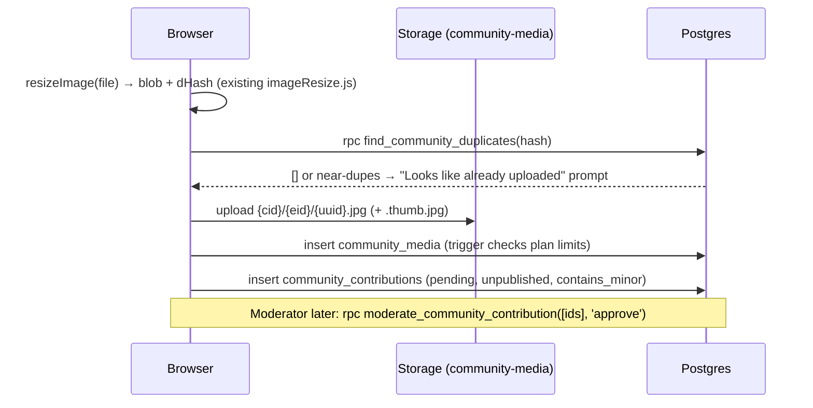

# 12 — API Design

The family product has three API surfaces, and Communities uses the same three:

1. **Direct table access.** `supabase.from(...)` under RLS. This is the default for almost every operation.
2. **Security-definer RPCs.** `supabase.rpc(...)`, used when an operation must write a table that has no client write policy, or must apply logic RLS cannot express. Examples in the family product are `redeem_invite`, `set_active_family` and `redeem_content_share`.
3. **Serverless endpoints.** `/api/*.js`, called with `apiFetch` (bearer token), used only when the service role, a third-party secret or a cron schedule is needed.

All table and column names below are defined in `11-database-design.md`.

## 1. Direct-from-browser operations (RLS)

These need no new server code. The **Policy** column names the RLS policy in doc 11 that guards each one.

| Operation | Call | Policy |
|---|---|---|
| List my communities (switcher) | `from('community_members').select('community_id, role, status, communities(name, slug)').eq('user_id', uid)` | `user can read own community memberships` (the embed of `communities` resolves only for the active community. For names of inactive ones, use the `my_communities()` RPC in §3) |
| Read community settings | `from('communities').select('*').single()` | `member can read own community` |
| Update settings | `from('communities').update({...})` | `admin can update own community` |
| Apply to join | `from('community_members').insert({community_id, user_id: uid, role:'resident', status:'pending'})` | `user can apply to join` |
| Approve/reject applicant, alumni | `from('community_members').update({status})` | `admin can manage roster` (role changes go through `set_role`, §4.1) |
| Blocks and units CRUD | `from('community_blocks'|'community_units')` | moderator write policies |
| Create my household, add members | `from('community_households').insert`, `from('community_household_members').insert` | `resident creates household`, `write household members` |
| Self-declare occupancy | `from('community_occupancies').insert({..., verified_by:'self_declared'})` | `declare occupancy` |
| Verify occupancy, end tenancy | `.update({verified_by:'committee'})`, `.update({end_date})` | `moderator updates occupancy` |
| Events and activities CRUD, go Live or Close | `from('community_events').insert/update({status:'live'})` | `moderator writes events` |
| List events for year X | `from('community_events').select('*').eq('event_year', X).order('starts_on')` | `read events` |
| Event gallery | `from('community_contributions').select('*, community_media(*)').eq('event_id', id).eq('visibility_state','published').order('created_at')` | `read contributions` + `read media` |
| Moderation queue | `from('community_contributions').select('*, community_media(*)').eq('status','pending').order('created_at')` | `read contributions` (moderator branch) |
| Upload a file | `storage.from('community-media').upload(path, blob)` | `upload community media` |
| Register uploaded file | `from('community_media').insert({...})` | `insert own media` + `enforce_community_media_limit` trigger |
| Submit for review | `from('community_contributions').insert({status:'pending', visibility_state:'unpublished', contains_minor, ...})` | `insert contributions` |
| Retract while pending | `from('community_contributions').delete().eq('id', id)` | `contributor withdraws own pending` (use the RPC once the item has been reviewed) |
| Set save-to-family rule | `from('community_media_permissions').upsert({...})` | `uploader or moderator sets permission` |
| Create event QR/link | `from('community_upload_links').insert({community_id, event_id, created_by: uid, expires_at, max_redemptions})` and read back `code` | `moderator creates link` |
| Revoke link | `.update({revoked_at: now})` | `moderator revokes link` |
| Signed URLs | `storage.from('community-media').createSignedUrls(paths, 3600)` | `read community media` |
| Audit log | `from('community_audit_log').select().order('created_at', {ascending:false}).limit(100)` | `admin reads audit log` |

**QR image.** The client builds `https://{APP_URL}/c/u/{code}` and renders the QR code in the browser with a small QR library such as `qrcode`, about 10 KB. It can be printed or downloaded as PNG. No server is involved and nothing is stored apart from the code.

## 2. Upload sequence (browser-only)



If the third insert fails, the object and the media row are left orphaned. The client retries the insert once. Otherwise the lifecycle sweep removes media rows that have no contribution after 24 hours, and objects that have no media row (doc 14 §6). The pilot has no multi-step transaction RPC for uploads. The family product does not have one either, and the sweep is enough.

## 3. RPC surface (security-definer Postgres functions)

These are grouped by purpose. The SQL for each is in doc 11, and the section is noted next to each one.

### Tenant resolution (called inside RLS, not usually from the client)

| Signature | Returns | Mirrors |
|---|---|---|
| `current_community_id()` | `uuid` | `current_family_id()` |
| `current_community_role()` | `text` | `current_family_role()` |
| `current_community_status()` | `text` | (new: alumni and pending states) |
| `is_community_moderator()` | `boolean` (admin or committee, active) | `is_moderator()` |
| `is_community_admin()` | `boolean` | `current_family_role() = 'head'` checks |
| `is_community_resident()` | `boolean` (not guest, active) | (new) |
| `is_own_community_household(p_household_id uuid)` | `boolean` | (new) |
| `has_community_event_grant(p_event_id uuid)` | `boolean` | (new) |
| `can_read_community_media(p_media_id uuid)` | `boolean` | (new: shared by table and storage policies) |
| `can_read_community_object(p_name text)` | `boolean` | (new: storage policy) |

### Client-callable

| Signature | Purpose | Errors (raised as text, shown in the UI as-is, like existing RPCs) |
|---|---|---|
| `set_active_community(p_community_id uuid) → void` | Switch space | "You are not a member of that community." |
| `set_active_space(p_space text) → void` | Return to family space (UI only) | |
| `my_communities() → table(community_id uuid, name text, role text, status text)` | Switcher list across all memberships (*add to the core migration*; RLS on `communities` only exposes the active one) | |
| `redeem_community_upload_link(p_code text) → table(r_community_id uuid, r_event_id uuid, r_event_title text, r_grant_expires_at timestamptz)` | QR landing | "isn't valid any more", "Uploads for this event have closed.", "reached its limit", "You no longer have access…" |
| `moderate_community_contribution(p_ids bigint[], p_verb community_moderation_verb, p_note text default null) → int` | All review state changes | "Only committee members can review items." The publish-gate CHECK violation is mapped client-side to "This photo is marked as possibly showing a child. Clear it individually first." |
| `withdraw_community_contribution(p_id bigint) → void` | Contributor retracts (DPDP) | "That item isn't yours to withdraw." |
| `community_unit_summary(p_block_id uuid) → table(unit_id, label, floor, occupied, household_name)` | Residential tree for residents | |
| `community_year_index() → table(event_year int, events bigint, items bigint)` | Yearbook strip | |
| `find_community_duplicates(p_hash text, p_max_distance int default 6) → table(media_id uuid, distance int)` | Pre-upload duplicate check | |

### Service-role-only (EXECUTE revoked from `authenticated`)

| Signature | Called by |
|---|---|
| `community_effective_limit(p_community_id uuid, p_key text) → bigint` | the `enforce_community_media_limit` trigger |
| `can_save_community_media_to_family(p_user uuid, p_media_id uuid, p_family_id uuid) → boolean` | `api/community-media.js` `save_to_family` |

```sql
-- my_communities(): add to 20261020120000_communities_core.sql
create or replace function public.my_communities()
returns table(r_community_id uuid, r_name text, r_role text, r_status text)
language sql stable security definer set search_path = public as $$
  select c.id, c.name, m.role::text, m.status::text
  from community_members m join communities c on c.id = m.community_id
  where m.user_id = auth.uid() and m.status in ('pending', 'active', 'alumni')
  order by c.name;
$$;
grant execute on function public.my_communities() to authenticated;
```

## 4. Serverless endpoints

Shared conventions, all taken from existing files:

- `POST` only, JSON body, `{ action, ... }`. Unknown action → `400 {"error":"Unknown action."}`. Wrong method → `405`.
- Auth is `Authorization: Bearer <supabase access token>`, which `src/lib/apiFetch.js` already attaches. Membership and role are re-derived on the server with the service client, the same as `requireModerator()` in `api/_memberAuth.js`. A new shared helper, `api/_communityAuth.js`, holds `requireCommunityRole(supabase, req, communityId, roles)`, and returns the caller's `community_members` row or throws an error message that is safe to show to the client.
- Every error body is `{"error": "<client-safe message>"}`, and upstream details are logged on the server only, as `ai-tools.js` does with `callOpenAI`.
- Superadmin actions accept the existing `ADMIN_PROVISION_SECRET` in a header, `x-admin-secret`, as `provision-family.js` does.

### 4.1 `api/community-admin.js`

| action | Auth | Request | Response | Notes |
|---|---|---|---|---|
| `provision` | superadmin secret | `{ name, slug, city?, adminEmail, adminDisplayName, tier? = "pilot" }` | `201 { communityId, adminUserId, tempPassword? }` | Inserts `communities`, `community_subscriptions` and the first `community_members` row with `role:'admin', status:'active'`. Creates the auth user when needed. Same flow as `provision-family.js`. |
| `import_units` | admin | `{ communityId, rows: [{ block, label, floor? }] }`, at most 2000 rows | `200 { blocksCreated, unitsCreated, skipped: [{ row, reason }] }` | Upserts blocks by `(community_id, name)` and units by `(community_id, label)`, in one transaction through a service client. Idempotent on re-upload. |
| `set_role` | admin | `{ communityId, memberId, role, title? }` | `200 { ok: true }` | Refuses to demote or remove the **last active admin**, which RLS cannot express. Writes through the service role, so the audit trigger records `actor_user_id = null`. The endpoint therefore also inserts an explicit `community_audit_log` row that names the caller. |
| `create_member_login` | admin or committee | `{ communityId, householdMemberId?, displayName, email \| phone }` | `201 { userId, tempPassword }` | For elderly residents. Mirrors `api/create-member-login.js`. |
| `reset_member_password` | admin | `{ communityId, userId }` | `200 { tempPassword }` | Mirrors `api/reset-member-password.js`, and only for users in that community |
| `set_subscription` | superadmin secret | `{ communityId, tier, status, limitOverrides? }` | `200 { ok: true }` | Writes `community_subscriptions` |

### 4.2 `api/community-media.js`

| action | Auth | Request | Response |
|---|---|---|---|
| `save_to_family` | signed-in | `{ mediaId, familyId, caption? }` | `201 { familyContributionId, alreadySaved: false }` or `200 { alreadySaved: true }` |
| `lifecycle_sweep` | `Authorization: Bearer ${CRON_SECRET}` (Vercel Cron) | `{}` | `200 { orphansDeleted, rejectedPurged, grantsExpired }` |

`save_to_family` steps:

1. Resolve the user from the token.
2. Call `rpc('can_save_community_media_to_family', { p_user, p_media_id, p_family_id })` with the service client. If it returns false, respond `403 {"error":"This photo can't be saved to a family archive."}`. The message is deliberately generic and never says why: minor, policy, or not published.
3. If `community_family_links (media_id, family_id)` already exists, return `alreadySaved`.
4. Download the object from `community-media` and upload it to `family-media` at `{familyId}/__community__/{uuid}.jpg`. This is a new reserved segment, chosen for the same reason as `__private__`: it can never collide with a slug.
   - The family's own `enforce_media_limit` trigger runs on this upload, so a family over its photo limit gets the standard 23514. Map it with the existing `friendlyLimitMessage` text.
5. Insert a family `contributions` row with `type:'photo', status:'Pending', contributor: '<name> (from <community name>)', contributor_user_id`. The item lands in the family's **own** review queue, the same way `redeem_content_share` brings content in.
6. Insert `community_family_links`.

**Family-side follow-up:** the family Storage read policy's second-segment logic has to tolerate `__community__`. It already treats any non-`__private__` second segment as family-readable, so **no family migration is needed**. This is confirmed against `20261013120000_contribution_visibility.sql`, whose clause is `(storage.foldername(name))[2] is distinct from '__private__' or ...`.

`lifecycle_sweep` details are in doc 14 §6.

**Function config:** add `"api/community-media.js": { "maxDuration": 60 }` to `vercel.json`, since sweeping and copying large videos can take time. Add the cron entry: `"crons": [{ "path": "/api/community-media?action=lifecycle_sweep", "schedule": "30 21 * * *" }]`. That is 03:00 IST. Vercel Cron sends a GET, so the handler accepts `GET` for this one action only.

### 4.3 `api/community-notify.js` (opt-in transactional only)

Decision #1 still holds: there is **no broadcast** and no "notify all residents". A message goes only to a user who opted in, and only about **their own** items or role.

| action | Auth | Request | Response |
|---|---|---|---|
| `optin_start` | signed-in | `{ communityId }` | `200 { waLink }`: a `https://wa.me/<TWILIO number>?text=JOIN-<6 hex code>` deep link. The *inbound* message proves ownership of the phone number, the same security property as `whatsapp_link_tokens`. |
| `optout` | signed-in | `{ communityId }` | `200 { ok: true }` |
| `send` | internal only: called from `community-media.js` or a DB webhook with `x-internal-secret` | `{ userId, communityId, template: 'items_approved' \| 'committee_role_granted', vars }` | `202 { sent: bool }`. Silently skipped when there is no opt-in or the template SID is unset, matching `TWILIO_NUDGE_TEMPLATE_SID` behaviour. |

Supporting table, to add to the core migration:

```sql
create table community_notification_optins (
  community_id uuid not null references communities(id) on delete cascade,
  user_id uuid not null references auth.users(id) on delete cascade,
  phone_number text,                 -- E.164, written ONLY by the webhook from the verified inbound number
  pending_code text unique,          -- JOIN-xxxxxx, cleared on confirm
  confirmed_at timestamptz,
  opted_out_at timestamptz,
  created_at timestamptz not null default now(),
  primary key (community_id, user_id)
);
alter table community_notification_optins enable row level security;
create policy "user reads own optin" on community_notification_optins for select using (user_id = auth.uid());
-- No client writes: optin_start/optout (service role) and the webhook only.
```

**Inbound side:** `api/whatsapp-webhook.js` gets one early branch. When the body matches `^JOIN-[0-9a-f]{6}$`, it looks up `community_notification_optins.pending_code`, writes `phone_number` from the Twilio-verified `From`, and replies "You'll get updates about your own photos from <community>. Reply STOP anytime." `STOP` sets `opted_out_at` on every community opt-in for that number. Signature validation already runs first, through `_whatsappAuth.js`. The branch never enters `_whatsappConversation.js`.

**Triggering "items approved":** the client calls `community-notify` after `moderate_community_contribution` returns. This is the pilot approach: simple, but best-effort. A Supabase Database Webhook on `community_moderation_actions` insert would be more reliable, and is Phase 2. Sends are batched per contributor per review session, so one person gets one message such as "12 of your photos are now in Diwali 2026", not twelve.

## 5. QR guests and authentication (open decision)

`redeem_community_upload_link` needs an `auth.uid()`. Today's login is email and password only, with no OTP and no anonymous sign-in. That is a lot of friction for someone who just scanned a poster at a pandal. Options:

| Option | Friction | Cost / risk | RLS impact |
|---|---|---|---|
| **A. Supabase anonymous sign-in** (`supabase.auth.signInAnonymously()`, recommended) | Scan, name, upload | Free. Abuse risk: anyone with the QR can upload, but only into **pending**, capped by `max_redemptions`, and only to one event. Enable Supabase's built-in CAPTCHA (hCaptcha/Turnstile) for anonymous sign-ins, and add per-IP rate limits in the Supabase Auth settings. | None. A real uid, so every policy works. The account can later be converted to email or phone with `updateUser` and keeps its uploads. |
| B. Phone OTP (Supabase phone auth via Twilio Verify) | Scan, phone, OTP, upload | About ₹0.5–1 per OTP. Strong identity. | None |
| C. Email/password signup | High | Low adoption expected | None |
| D. No auth: serverless signed-upload URL | Lowest | A new trust path outside RLS, and no uploader identity for withdrawal or DPDP requests | Bypasses RLS, so not recommended |

Recommendation: **A for the pilot, with B as an upgrade path.** Anonymous-auth guests get `role='guest'`. They see only their own uploads, and their uploads are always pending. *This needs product-owner sign-off, and anonymous sign-ins must be enabled in **both** Supabase projects' Auth settings. That is a dashboard setting, not a migration, so add it to the environment checklist in `docs/ENVIRONMENTS.md`.*

## 6. Error-mapping notes

- PostgREST `23514` from `enforce_community_media_limit` keeps its message, because the trigger is on a table, not on `storage.objects`. Show it as-is.
- The publish-gate CHECK, `community_contributions_publish_gate`, appears as `23514` with the constraint name in `details`. Map it to the minor-hold message.
- The Storage API's generic `403` on upload means the guest's grant has expired or the event is closed. Map it to "Uploads for this event have closed."
