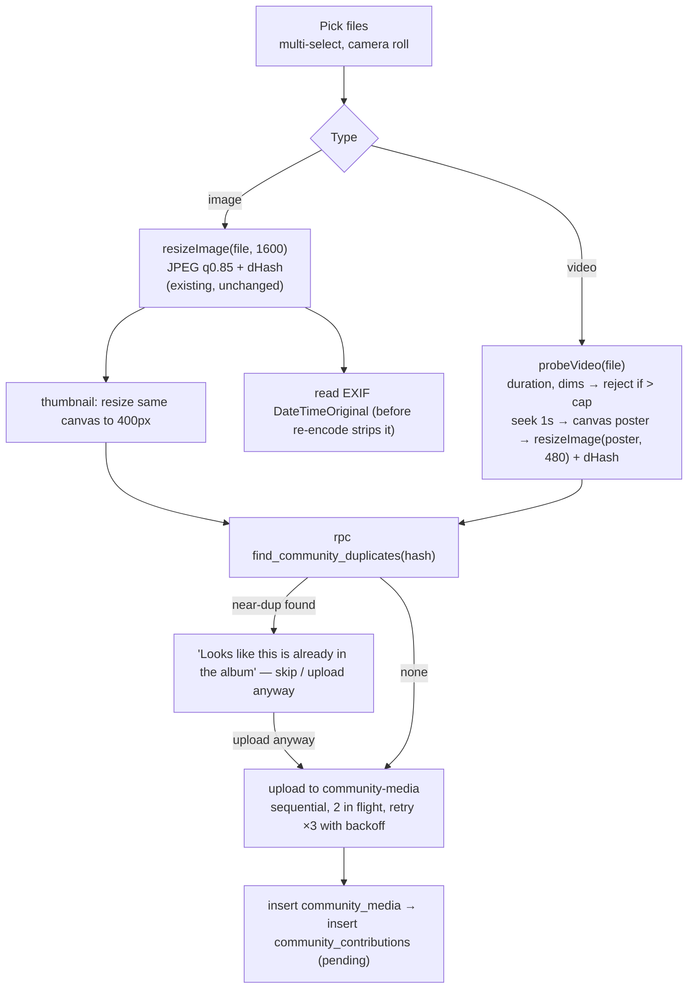

# 14 — Media Processing Strategy

**Principle:** process in the browser, store files as they are, and add no server media infrastructure for the pilot. The family product already works this way: `src/lib/imageResize.js` resizes and hashes on the device, and storage is a private Supabase bucket. The pilot needs nothing it doesn't already have, apart from a parameterised upload helper, a video poster frame and a cleanup cron.

## 1. Context that drives the decisions

- **Mobile-first, low bandwidth.** Uploads mostly come from mid-range Android phones on 4G at a crowded festival venue: congested towers, intermittent signal. A 4 MB camera JPEG multiplied by 40 photos is 160 MB per person. That is not viable. After resizing it is about 300 KB × 40 = 12 MB.
- **Burst load.** Uploads cluster in the 48 hours after a big event (doc 07: festival season, August to November). Pilot scale is 100–500 flats. A realistic peak is about 3,000 photos and about 100 short videos for one Diwali.
- **Moderation is human.** The committee reviews everything (doc 11 §8). So processing only has to make review fast through thumbnails and duplicate flags. It does not need to make decisions automatically.

## 2. Upload pipeline



### 2.1 Generalising `mediaUpload.js`

Today `mediaUpload.js` hard-codes `BUCKET = "family-media"` and the `{familyId}/...` path prefix. The refactor splits it into a tenant-agnostic core and two thin wrappers, so the family call sites stay unchanged:

```js
// src/lib/mediaStore.js (new) — tenant-agnostic core
export function createMediaStore({ bucket, signedUrlTtlSeconds, friendlyLimitMessage }) {
  return {
    async upload(path, blob) { /* supabase.storage.from(bucket).upload(path, blob, {contentType: blob.type, upsert: false}) + 23514 mapping */ },
    async resolve(path) { /* createSignedUrl(path, signedUrlTtlSeconds) */ },
    async batchResolve(paths) { /* createSignedUrls in chunks of 50 */ },
  };
}

// src/lib/mediaUpload.js — unchanged exports, now a wrapper
const store = createMediaStore({ bucket: "family-media", signedUrlTtlSeconds: 60 * 60 * 24 * 365, friendlyLimitMessage });
export const uploadFamilyMedia = (familyId, personId, blob, ext) => store.upload(`${familyId}/${personId}/${crypto.randomUUID()}.${ext}`, blob) /* … */;

// src/lib/community/communityMedia.js — new wrapper
const store = createMediaStore({ bucket: "community-media", signedUrlTtlSeconds: 60 * 60 }); // 1 hour — see 2.3
export function communityMediaPath(communityId, eventId, ext, suffix = "") {
  return `${communityId}/${eventId ?? "_none"}/${crypto.randomUUID()}${suffix}.${ext}`;
}
```

The family wrapper keeps its 1-year TTL and its exact path shapes, so the change has no effect on the family product. A single test case is enough to cover it: a family photo upload, followed by a reload, still renders.

### 2.2 Images

- **Resize:** `resizeImage(file, 1600)` as it is today, producing JPEG at q0.85. That is about 200–400 KB for a typical phone photo. The function already returns the dHash from the same decoded canvas.
- **Thumbnail:** a second, 400px JPEG at q0.75, about 25–40 KB, drawn from the already-decoded canvas. It is stored at `{...}.thumb.jpg` and recorded in `community_media.thumb_path`. The gallery grid and the moderation queue load only thumbnails. On 4G, a grid of 60 thumbnails is about 2 MB, compared with about 18 MB for full-size images. The family product does not do this today, because its galleries are small. Community event albums are not.
- **EXIF date:** the re-encode removes EXIF. Before resizing, read `DateTimeOriginal` from the first 64 KB of the original file with a tiny parser, roughly 1 KB of code; no library is needed. Store it in `taken_at`. This is useful for sorting and for flagging uploads with a wrong date ("this photo was taken in 2019 but you're adding it to Diwali 2026"). Stripping EXIF is also a privacy feature, because it removes GPS. Keep that property: never upload the original.
- **HEIC** (iPhone): `` decoding of HEIC works in Safari but not in Chrome. Use `<input accept="image/*">`, because iOS hands over a JPEG for camera-roll picks in most cases. If decoding fails, show "Please share this photo as JPEG", which is the existing `resizeImage` error path. HEIC decode via WASM is deferred. This is a low-frequency case in an Android-dominant pilot.

### 2.3 Signed-URL lifetime: a deliberate difference from the family product

The family product signs URLs for one year and resolves everything when the app starts. Community media **must not** do this. A signed URL keeps working after an item is hidden, withdrawn or put on minor hold. A one-year URL would mean a takedown does nothing for anyone who had already loaded the gallery. Community URLs are therefore signed for **1 hour**, in batches of 50, page by page as the gallery scrolls, and re-signed when they expire. That is an `onError` on `` that triggers a re-sign, at most once. This also keeps start-up light, because nothing community-related is hydrated until a community view opens.

### 2.4 Upload transport

- **Concurrency:** 2 uploads in flight, 3 retries with exponential backoff of 1 s, 4 s and 15 s. Queue progress shows per file: "12 of 40 uploaded". On a weak connection, sequential uploads with retry are more reliable than six parallel ones that all time out.
- **Survives backgrounding:** the queue state, meaning the file handles still pending, is kept in memory only. If the tab is killed, the user re-picks. Persisting queued blobs in IndexedDB is a Phase 2 improvement, worth doing if pilot analytics show many abandoned partial uploads.
- **Resumable uploads (TUS)** for videos over 6 MB. Supabase Storage supports TUS at `/storage/v1/upload/resumable` through `tus-js-client`, which is about 20 KB. It is used for video only. A 400 KB photo gains nothing from it. This is the one new client dependency the pipeline needs.

## 3. Duplicate detection (existing dHash, reused)

- `computeDHash` (`src/lib/imageHash.js`) is used unchanged. It survives re-encoding and resizing, which matters here because five residents will upload the same WhatsApp-forwarded photo of the lamp-lighting.
- **When it runs:** before upload, in the browser, through `rpc find_community_duplicates(hash, 6)`. It runs in SQL as definer because residents cannot read every hash through RLS (doc 11 §12). A Hamming distance of 6 bits or fewer out of 64 counts as a near-duplicate. Calibrate this against the family product's existing Admin > Duplicates threshold so both products use one number. Put the threshold in a shared constant in `imageHash.js`.
- **Within a batch:** the client also compares hashes inside the batch being uploaded, so the same photo picked twice is caught before it touches the network.
- **What it does:** it **suggests** skipping. It never blocks. "Upload anyway" stays available, because near-identical burst shots are often wanted. The moderation queue also shows a "possible duplicate of …" badge, using the same RPC called by the moderator, so the committee can reject extras with a single tap.
- **Video:** the dHash of the poster frame catches the same clip re-forwarded. It is weak, which is acceptable.
- **Backfill:** not needed, because there is no existing community data. `scripts/backfill-image-hashes.mjs` is the template if one is ever needed.

## 4. Video strategy: store as uploaded, poster frame only

**Decision:** no server transcoding in the pilot. Store the file the phone produces (MP4/H.264, or MOV from iPhones) and generate a poster thumbnail in the browser.

**Reasons:**
1. **Nothing exists to reuse.** The repo has no transcoding pipeline, no ffmpeg and no job queue. Vercel serverless functions are the wrong place for ffmpeg: the binary is large, and the time and memory limits are tight, even on Pro. A real transcoding service, such as Mux or Cloudflare Stream, would be new infrastructure, a new vendor and a new cost line.
2. **Phone output already plays almost everywhere.** Android and iPhone record H.264 or HEVC in an MP4 or MOV container. H.264 plays in every browser. HEVC MOV plays on Safari, on iOS, and on most recent Android Chrome versions with hardware decode. A clip that fails to play gets a "Download to watch" link as a fallback.
3. **Caps make bandwidth acceptable without transcoding:**
   - **Duration cap:** 180 s by default, the `videoSeconds` plan limit, enforced by the trigger and pre-checked in the client.
   - **Size cap:** 100 MB, the bucket's `file_size_limit`. In practice a 60 s 1080p phone clip is 60–130 MB, so the client advises "Videos up to about 1 minute work best", and warns above 50 MB on a cellular connection where `navigator.connection` reports it.
   - **Optional client-side downscale.** Phase 2: re-encode to 720p through `MediaRecorder` and canvas, or WebCodecs. This is CPU-heavy on low-end phones and gives inconsistent results across browsers, so it is not in the pilot.
4. **Volume is low.** About 100 videos per big event. Even with no transcoding, the storage cost is only a few GB a year (§6).

**Poster frame:** load the file into an off-screen `<video>` with `preload="metadata"`, read `duration`, `videoWidth` and `videoHeight`, seek to `min(1, duration/2)`, draw the frame to a canvas, and pass it through `resizeImage` at 480px. That gives the thumbnail and the dHash. If seeking fails, as with some HEVC on Chrome, use a generic video tile and set `image_hash = null`.

**Playback:** `<video preload="none" poster={thumbUrl} controls>`. Nothing downloads until the user taps play, which is essential for a 40-tile gallery on 4G.

**Audio** (elder interviews, Phase 2 voice memories): store webm or m4a as-is. Transcription reuses the Whisper helper pattern from `api/_whatsappMedia.js`, behind the `_aiAuth.js` gate extended with a community tier. This is Phase 2 and not required for the pilot.

## 5. What runs where

| Step | Where | New code? |
|---|---|---|
| Resize, JPEG re-encode, EXIF strip | Browser | No (`imageResize.js`) |
| Thumbnail (400px) | Browser | Small addition |
| dHash | Browser | No (`imageHash.js`) |
| EXIF date read | Browser | Tiny parser |
| Video probe and poster | Browser | New, about 60 lines |
| Duplicate lookup | Postgres RPC | New SQL (doc 11 §12) |
| Plan-limit enforcement | Postgres trigger | New SQL (doc 11 §11) |
| Lifecycle cleanup | Vercel Cron and `api/community-media.js` | New |
| Transcoding, blur, faces, classification | Nowhere (deferred) | — |

## 6. Storage lifecycle and retention

| State | Retention | Mechanism |
|---|---|---|
| Published | Indefinite, for the life of the community. This is the product promise of institutional memory. | — |
| Pending | Indefinite while pending. The admin home shows a "pending more than 30 days" nudge. | UI |
| Approved and minor-held | Indefinite. It stays held until cleared or rejected. | — |
| Hidden (takedown) | 90 days, then the file is purged. Rows are kept with `storage_path` tombstoned to `purged:` so the history and audit log remain. | Sweep |
| Rejected or withdrawn | **30-day grace period** (the uploader can ask the committee to reconsider), then the file is purged | Sweep |
| Orphaned object (no `community_media` row after 24 h) | Deleted | Sweep |
| Orphaned media row (no contribution after 24 h) | Deleted, along with its object | Sweep |
| Expired event grants | Rows deleted after 30 days past `expires_at` | Sweep |
| Removed member's uploads | Stay published under the community licence, unless the person requests removal. That request goes through `withdraw_community_contribution` by the committee on their behalf (doc 06 §4). | Manual |
| Copies saved into a family archive | Independent copies, governed by the family product. A community takedown notifies the saver through `community_family_links`; it does not force-delete. | Doc 11 §15 decision 3 |

**The `lifecycle_sweep` action** (daily at 03:00 IST, `api/community-media.js`):

1. Select up to 500 objects per run from each category above, using the service client, and order by age.
2. Delete through `storage.from('community-media').remove(paths)`. Never delete `storage.objects` rows directly with SQL, because Supabase does not support that and it leaves the bytes behind.
3. Then update the rows: tombstone the path, or delete the row.
4. Return counts, which appear in the Vercel cron logs.

The work is idempotent and runs in batches, so a missed day just catches up the next day. It runs identically in test and production, each against its own project.

**Storage volume estimate for the pilot.** About 6 big events and about 20 small ones a year:
- Photos: about 8,000 per year × 350 KB, plus thumbnails (≈ 35 KB each), is about 3 GB.
- Video: about 300 per year × 60 MB is about 18 GB. Video dominates.

The total is about 21 GB in year one. That fits within Supabase Pro's included 100 GB with plenty of room. The `pilot` tier's `storageBytes` is 50 GB (doc 11 §11). That leaves headroom, and the trigger is still a real ceiling.

**Backups.** Storage objects are not covered by Supabase's database backups. `scripts/backup.mjs` (`docs/BACKUPS.md`) already handles `family-media`. Extend it with a bucket list so `community-media` is mirrored the same way. This is a one-line change to the configuration, not a new script.

## 7. Deferred to Phase 2/3

| Capability | Phase | Reason it is deferred |
|---|---|---|
| **Blur / low-quality detection** | 2 | Nothing like it exists in the repo, and the payoff is uncertain. The committee already sees every photo in review and rejects blurry ones with one tap. |
| **Face clustering / "photos of my family"** | 3 | New infrastructure (embeddings and a vector store), no in-house precedent, and high privacy risk, especially for minors. Under DPDP this is biometric-adjacent processing that needs explicit consent. |
| **Automatic minor detection** | 3 | Same face-model infrastructure as above. Wrongly marking a photo "no child present" is the dangerous error, so the human flag (`contains_minor` defaulting to null-as-true) stays the control even after this exists. |
| **AI activity classification** (e.g. "rangoli", "aarti") | 2 | The GPT-vision plumbing exists (`callOpenAI`, `_aiAuth.js`), but cost per image at festival volume is uncertain, and activities are already chosen by hand at upload. |
| **AI captions / album summaries** | 2 | Same plumbing as classification. It is useful for the yearbook but not needed to prove the pilot's core loop. |
| **Server-side video transcoding / adaptive streaming** | 2–3 | New vendor or infrastructure (Mux, Cloudflare Stream or similar). Phone output plays well enough at pilot scale (§4). |
| **Client-side video downscale** | 2 | Inconsistent across browsers and heavy on CPU for low-end phones |
| **HEIC decoding in the browser** | 2 | WASM decoder of about 1 MB, for a low-frequency case on an Android-majority pilot |
| **Upload queue that survives the tab being killed** (IndexedDB) | 2 | Only worth building if pilot data shows many abandoned uploads |
| **Voice-memory transcription** | 2 | Whisper helper is reusable, but voice is not part of the pilot's photo-first loop |
| **Bulk event ZIP export** | 2 | Serverless zip streaming for large albums needs care with time limits. Committees can download per item for now. |

## 8. Open items for the product owner

1. **Video caps.** The proposal is 180 s and 100 MB hard limits, with "about 1 minute" as the advice shown to users. Some committees will want full cultural-programme recordings of 20 minutes or more. Those need either a transcoding vendor or a "link to YouTube" item type. Which one?
2. **Rejected-item grace period.** 30 days is proposed. Shorter is better for privacy, longer for appeals.
3. **Original-quality archive.** The pipeline never keeps originals, which saves bandwidth and strips EXIF GPS. Some photographers will want full resolution. A "committee photographer upload originals" mode is possible later, at a storage cost.
